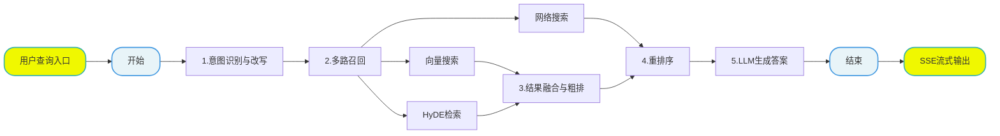

# 工具类

## logger

```python
# 注意context_id  标识request_id session_id

http://127.0.0.1:8000/docs#/
```

```python

http://minio.org.cn/
http://minio.org.cn/docs/minio/linux/developers/python/API.html

https://milvus.io/docs/zh/sparse-inverted-index.md

# MinerU
https://mineru.net/apiManage/token

https://bailian.console.aliyun.com/cn-beijing/store/mcp/detail/WebSearch

https://skillsmp.com/zh

https://openai.github.io/openai-agents-python/zh/mcp/

https://hf-mirror.com/Qwen/Qwen3.8-27B
# AI画原型
https://axhub.im/
# 硅基流动
https://cloud.siliconflow.cn/me/dedicated/apply
```


# 知识库构建

## state

##### 配置管理

`dataclass` 是 Python 3.7+ 的装饰器，用于简化类定义：

```python
from dataclasses import dataclass, field

@dataclass
class Config:
    # 简单默认值
    name: str = "default"

    # 动态默认值（使用 field + default_factory）
    items: list = field(default_factory=list)

    # 从环境变量读取
    api_key: str = field(
        default_factory=lambda: os.getenv("API_KEY", "")
    )
```

`field()` 函数用于为数据类的字段提供更精细的控制，当简单的赋值语法无法满足需求时（例如需要可变类型的默认值），就需要用到它。

下面我们来逐一解析你代码中的三种情况：

###### 📝 简单默认值

这是一种语法糖，适用于**不可变类型**（如 `str`, `int`, `float`, `bool`, `tuple`）的静态默认值。 

```python
name: str = "default"
#等同于
name: str = field(default="default")
```

###### ⚙️ 动态默认值 (`default_factory`)

这是 `field()` 最重要的用途之一，专门用于处理**可变类型**（如 `list`, `dict`, `set`）的默认值。

```python
items: list = field(default_factory=list)
```

- **为什么需要它？**
  如果直接写成 `items: list = []`，那么这个空列表 `[]` 会在类定义时被创建一次，并被所有 `Config` 实例共享。修改一个实例的 `items` 会影响所有其他实例，这是一个常见的陷阱。
- **它是如何工作的？**
  `default_factory` 参数接收一个**无参的可调用对象**（也叫工厂函数）。每次创建一个新的 `Config` 实例时，`dataclass` 都会自动调用这个工厂函数，并将它的返回值作为该字段的初始值。
  - `list` 本身就是一个无参构造函数，调用 `list()` 会返回一个新的空列表。
  - 因此，`default_factory=list` 确保了每个 `Config` 实例都拥有自己独立的、全新的空列表，从而避免了数据共享的问题。

###### 🌐 从环境变量读取默认值

```python
api_key: str = field(
    default_factory=lambda: os.getenv("API_KEY", "")
)
```

这是 `default_factory` 的一个高级应用，展示了它的灵活性。

- **`lambda` 表达式的作用**
  这里使用了 `lambda` 创建一个匿名的无参函数。这个函数的作用是调用 `os.getenv("API_KEY", "")` 来获取环境变量的值。

- **为什么用 `lambda`？**
  因为我们需要在每次实例化时执行一段逻辑（获取环境变量），而不仅仅是调用一个简单的构造函数。`lambda: ...` 完美地满足了 `default_factory` 需要一个“无参可调用对象”的要求。

  这行代码等价于先定义一个普通函数，再传给 `field`：

  ```python
  def _get_api_key():
      return os.getenv("API_KEY", "")
  
  class Config:
      # ... 其他字段
      api_key: str = field(default_factory=_get_api_key)
  ```

###### 🧪 代码示例与测试

```python
# test/02_dataclass_field.py

from dataclasses import dataclass, field


@dataclass
class User:
    # 1. 必需字段：没有默认值，创建实例时必须提供
    username: str

    # 2. 简单默认值：适用于不可变类型 (str, int, float等)
    age: int = 18

    # 3. 动态默认值：适用于可变类型 (list, dict等)，防止实例间共享状态
    tags: list = field(default_factory=list)


# --- 开始测试 ---

print("--- 测试 1: 只提供必需字段 ---")
user1 = User("Alice")
print(f"user1: {user1}")
# 输出: user1: User(username='Alice', age=18, tags=[])

print("\n--- 测试 2: 提供所有字段 ---")
user2 = User("Bob", 25, ["developer", "pythonist"])
print(f"user2: {user2}")
# 输出: user2: User(username='Bob', age=25, tags=['developer', 'pythonist'])

print("\n--- 测试 3: 验证可变默认值的独立性 ---")
# 这是使用 field(default_factory=list) 的关键原因
user3 = User("Charlie")
user4 = User("David")

# 修改 user3 的 tags 列表
user3.tags.append("new_tag")

print(f"user3.tags: {user3.tags}")
print(f"user4.tags: {user4.tags}")

# 如果这里使用的是 tags: list = []，那么 user4.tags 也会包含 'new_tag'
# 但因为使用了 default_factory，每个实例都有自己独立的列表
# 输出:
# user3.tags: ['new_tag']
# user4.tags: []
```

###### 总结

| 场景               | 适用类型                    | 写法                                        | 目的                                           |
| :----------------- | :-------------------------- | :------------------------------------------ | :--------------------------------------------- |
| **静态默认值**     | 不可变类型 (`str`, `int`等) | `name: str = "default"`                     | 设置一个固定的、安全的默认值。                 |
| **动态默认值**     | 可变类型 (`list`, `dict`等) | `items: list = field(default_factory=list)` | 为每个实例生成一个独立的新对象，避免共享状态。 |
| **复杂逻辑默认值** | 任何类型                    | `field(default_factory=lambda: ...)`        | 在实例化时通过执行函数来动态计算默认值。       |

## node_entry

```python
"""
节点作用：接收传入的文件地址 local_file_path 识别文件类型，修改对应的state
入参：local_file_path,task_id
出参：is_md_read_enabled/is_pdf_read_enabled,    md_path/pdf_path,    file_title
步骤：
	1、获取state中数据 local_file_path,task_id
	2、进行文件校验 local_file_path是否为空
	3、文件地址判断文件类型，修改对应的state参数即可
	4、识别文件地址对应的文件类型
	5、返回结果和状态
"""
```

技术细节说明

| 语法 / 函数                       | 具体作用                            | 执行示例                                        |
| :-------------------------------- | :---------------------------------- | :---------------------------------------------- |
| `os.path.basename(document_path)` | 从完整路径提取文件名                | `/data/kb/test.pdf` → `test.pdf` p.stem         |
| `splitext(file_name)`             | 拆分文件名和后缀                    | `test.pdf` → `('test', '.pdf')`                 |
| `state.get("key", "")`            | 安全提取状态值，无 key 时返回默认值 | `state.get("a", "")` → 无 "a" 则返回 ""         |
| `sys._getframe().f_code.co_name`  | 动态获取当前函数名                  | 本节点中返回 `node_entry`                       |
| `add_running_task/add_done_task`  | 记录任务的节点运行状态              | 用于任务监控面板，展示节点执行进度(fastapi使用) |

## node_pdf_to_md

```python
"""
节点作用：将pdf转为md，并且保存，同时修改state参数
入参：[pdf_path:str:Path,    local_dir:str:Path 默认存储文件地址 （项目/outputs）]
出参：md_path:str,    md_content:str
步骤：
	1、step_1_validate_paths 校验pdf和输出路径
	2、step_2_upload_and_poll minerU进行交互
	3、step_3_download_and_extract 下载提取和解压
	4、根据md地址读取对应md_content内容，并且更新state
	5、返回结果和状态

具体步骤：
1、step_1_validate_paths 校验pdf和输出路径
	入参：state
	出参：pdf_path_obj:Path,    local_dir_obj:Path
	步骤:
	1、state获取对应的地址
	2、进行非空校验（path -> none -> 结束 |local_dir 给与默认地址）
	3、将两个参数转成Path（str-> Path）
	4、判断pdf_path_obj是否有文件，local_dir_obj是否存在文件夹
		没有文件 -》 抛出异常
		没有文件夹 -》 创建文件夹 
	5、返回两个文件路径
	
2、step_2_upload_and_poll minerU进行交互
	入参：pdf_path_obj
	出参：zip_url:str
	步骤:
	1、参数校验（minerU -> 检查下miner url和key）
	2、申请上传地址（minerU）[batch_id]
	3、向执行地址进行上传文件
	4、轮询获取返回结果（zip_url）[batch_id]
	5、返回zip_url
	
3、step_3_download_and_extract 下载提取和解压
	入参：zip_url local_dir_path pdf_path_obj/pdf_path_obj.stem
	出参：新的md_path_obj[Path]
	步骤:
	1、向指定的zip地址发起请求获取响应response
	2、将响应数据写到本地磁盘[local_dir_path/pdf_path_obj.stem/stem.zip]
	3、先清空解压文件夹的原文件
	4、再次解压即可（避免出现脏数据）
	5、检查是否存在md文件
	6、进行md文件的命名确定[xx.pdf -> full.md -> xx.md]
	7、返回md_path_obj地址

实操：
    # 1、先向指定地址，发起请求获取下载的文件内容zip
        """
        参数：url，headers，json，data
        """
    # 2、将下载内容写到本地磁盘 local_dir / 文件名_result.zip
    # 3、准备解压对应的文件夹 local_dir/ 文件名 【先删除原来的文件内容 | 再解压内容】
    # 4、检查解压后的文件夹是否存在md文件
    # 5、检查md文件的命名，统一改为 文件名.md
    # 6、返回md对应的Path对象即可

4、根据md地址读取对应md_content内容，并且更新state

"""
```


| 函数 / 方法                 | 所属模块 / 对象 |                           核心作用                           |                           关键特点                           |
| :-------------------------- | :-------------: | :----------------------------------------------------------: | :----------------------------------------------------------: |
| `zipfile.ZipFile(..., 'r')` |     zipfile     |         以只读模式打开 ZIP 压缩包，创建 ZIP 操作对象         |     需配合`with`语句使用，自动释放文件句柄，避免资源泄漏     |
| `zip_file_obj.extractall()` | zipfile.ZipFile | 将 ZIP 包内**所有文件 / 目录**解压至指定目录，保留原内部目录结构 |    一键解压，无需遍历文件，适配 MinerU 返回的 ZIP 包格式     |
| `shutil.rmtree()`           |     shutil      |            递归删除指定目录及所有子文件 / 子目录             | 比`os.rmdir`更彻底（os.rmdir 仅删除空目录），适合清理旧解压目录 |
| `Path.rglob("*.md")`        |  pathlib.Path   |    递归遍历当前目录及**所有子目录**，匹配指定通配符的文件    | 相比`glob()`（仅当前目录），更适配解压后可能的多层子目录结构 |
| `Path.with_name(新文件名)`  |  pathlib.Path   | 基于原路径，**仅修改文件名**，保留父目录，返回**新的 Path 对象** | 不修改实际文件，仅生成路径；自动保留父目录，无需手动拼接路径 |
| `Path.rename(新路径)`       |  pathlib.Path   | 将文件 / 目录从原路径**重命名 / 移动**至新路径，实际修改文件系统 | 若新路径已存在会报错；需捕获异常，处理文件被占用 / 权限不足等场景 |

总结：为什么 PUT 需要 Session 而 POST/GET 不需要？

1. POST/GET 不需要 ：
   它们是普通的业务接口，只要 Token 对了就能过。即使你的请求经过了代理（比如开了 VPN），Header 里多了一些代理信息（如 Via ），服务端通常会 忽略 这些杂质，照样处理，所以直接用 requests.post/get 也没事。
2. PUT 必须需要 Session (trust_env=False) ：它使用的是 预签名 URL (Presigned URL) 直连对象存储（如 OSS/S3）。这种接口有 极其严格的签名校验机制 ：

   - 不开 Session (trust_env=True) ：如果你的电脑有代理，代理服务器可能会偷偷往 Header 里加东西（如 Via , Connection: close ）。服务端收到后，发现请求头和签名里约定的不一样，判定为 请求被篡改 ，直接报错 403 SignatureDoesNotMatch 。
   - 开了 Session (trust_env=False) ：强制绕过系统代理，发送 纯净无杂质 的原始请求。服务端校验签名一致，上传成功。
     一句话 ：POST/GET 是宽进宽出，怎么发都行；PUT 是 字节级校验 ，必须用 Session 确保请求头一个标点符号都不被代理修改。

## node_md_img

```python
"""
节点作用：将本地图片地址上传到minio服务器，识别图片的内容转成文本！替换md内容
入参：[md_path:找到对应图片,    md_content:被替换]
出参：md_content：被替换后的md_content继续作为切割的材料  备份md_content md_path 新的
步骤：(省略人物管理 running_task,done_task)
	1、step_1_get_content 进行参数校验和获取材料
	2、step_2_scan_image  扫描图片的上下文
	3、step_3_image_summary 调用视觉模型，传入图片的对应上下文，获取图的文本内容
	4、step_4_upload_images_replace 将图片文件传入minio服务器，并且进行md中的图片替换（描述 网络地址）
	5、step_5_backup_md_file 将新的md内容进行备份处理
	6、更新state信息 md_path md_content

具体步骤：
1、step_1_get_content
    作用：进行参数校验和获取材料
	入参：state
	出参：md_path_obj:Path, md_content,  md_image_dir_obj Path
	步骤:
	1、state获取对 md_path 和md_content
	2、进行非空校验（为空异常ValueError）
	3、md_path转成md_path_obj Path
	4、md_path_obj 获取images 所在的文件夹 .parent / images
	
2、step_2_scan_images
	作用：找到图片的本身信息和图片的上下文信息
	入参：md_content，md_image_dir_obj
	出参：[("图片名","图片地址",(上文100,下文100))]
	步骤:
	1、获取图片文件夹中所有图片对象
	2、循环遍历图片对象
	3、定义对应的正则规则   
	4、md中进行正在匹配 Match =re.search(md)
	5、Match对象获取图片的坐标信息(.span() .start() .end() .group())
	6、md中截取上文和下文 md_content [start-100:start]  [end:end+100]
	7、拼接结果内容(对象.name,str(对象),(上文,下文))
	
3、step_3_image_summary 
    作用：使用视觉模型识别图片描述内容
	入参：[("图片名","图片地址",(上文100,下文100))] md_path_obj.stem(图片所在的文件夹的名字)
	出参：dict {图片名:图片总结}
	步骤:
	1、准备工作：获取模型客户端对象
	2、获取上次获取图片的上下文
	3、封装提示词
	4、使用模型执行
	5、获取结果 装到dict中
	6、返回结果

4、step_4_upload_images_replace 
    作用：将图片文件传入minio服务器，拼接网络地址，并且进行md中的图片替换（描述 网络地址）
    入参：[("图片名","图片地址",(上文100,下文100))]  dict {图片名:图片地址总结}
    出参：md_content 替换后的   --> 
    步骤：
    1、获取minio客户端对象 minio_client
    2、删除原文件名对应的minio对象
    3、循环“图片地址” 向minio服务器传递文件，并且拼接（端点/桶名/文件名）和记录地址{"图片名":"minio图片地址"}
    4、{"图片名":"minio图片地址"} {图片名:图片总结} --合并--> {"图片名":("minio图片地址","图片总结和描述")}
    5、替换 md_content 内容 循环处理 正则 | rep.sub("要替换的内容"，md_content)
    6.最终返回md_content
    
5、step_5_backup_md_file 
    作用：将新的md内容进行备份处理
    
"""
```

```python
"""
滑动窗口限流
1、清理滑动 串口外的过期请求时间戳，保证队列仅存窗口内的请求
2、窗口内请求达上限，计算并阻塞等待剩余时间
	2.1 计算需要等待的时长
	2.2 等待后更新当前时间，重新清理过期请求（避免等待期间有请求过期）
3、记录当前时间戳，加入滑动窗口队列
""”
```

**实现思路**:
1.  **图文解耦与云端持久化**：本地图片批量上传至MinIO，实现存储与计算分离，保障跨环境可访问、高可用，支撑大规模知识库扩展。
2.  **视觉语义增强**：引入VLM多模态模型，结合图片上下文，生成精准中文语义描述，让图片具备文本检索能力，填补传统RAG视觉知识盲区（区别于单纯OCR识别）。
3.  **企业级稳定性保障**：内置API速率控制（令牌桶算法）、格式校验、旧资源清理、异常捕获，确保大批量图片处理稳定无崩溃。
4.  **全流程自动化**：从扫描、语义生成、上传、替换到保存，全程无人工干预，不改变原有MD格式，无缝对接后续节点。

```python
"""
#### 步骤分解
1.  **Step 1：初始化校验**：读取MD路径与内容，校验文件合法性，定位同级images文件夹。
2.  **Step 2：图片扫描与上下文匹配**：筛选支持格式的图片，校验MD引用关系，截取图片前后各100字符上下文。
3.  **Step 3：VLM语义生成**：调用千文Qwen3-VL-Flash，Base64编码图片+上下文构造请求，生成规范语义描述。
4.  **Step 4：上传与替换**：清理MinIO旧资源，批量上传图片生成在线URL，替换MD本地路径并填充alt语义。
5.  **Step 5：保存与状态更新**：生成「原文件名_new.md」备份，更新流程状态，完成闭环。
"""
```

## node_document_split

```python
"""
节点作用：对md_content进行合理的切割
入参：md_content md_path file_title
出参：chunks[ {content,title,parent_title,part,file_title}]
宏观步骤：
	1、step_1_validate_clean 数据校验和清洗
	2、step_2_data_chunk_title 按照语义进行数据切割[文档中没有标题]
	3、step_3_data_refind_chunk 检查有没有超过指定的快，进行二次细分切割
	4、step_3_data_deal 完善数据格式，补齐part parent_title
	5、step_5_data_deal 数据备份处理，chunk.json
	6、修改state属性 chunks -> chunk切块列表即可
详细步骤
1、step_1_validate_clean
	作用：数据校验和清洗
	入参：state[md_content md_path file_title]
	出参:md_content[清洗过]  file_title
	步骤：
	1、获取数据 md_content md_path file_title
	2、md_content 进行非空校验 空-->异常
	3、md_content 不为空 --> 数据清洗 --> 字符串统一替换
	4、file_title 进行非空判断 空-->通过 md_path 获取 file_title
	5、数据返回即可
2、step_2_data_chunk_title
	作用：按照语义进行数据切割[文档中没有标题]
	入参：md_content,file_title
	出参:chunks = [{content,file_title,title}]
	步骤：
reg =re.compile(r"^\s*#{1,6}\s.+")
chunks=[]
current_title=标题 ## 标题1\n
title_lines=[文本内容 \n  \n, <table> \n]
is_code_block=False # [进入 和 出去]
chunk_size = 0
	1、先根据 \n 换行将md进行切割 [行，行，行，行，行，]
	2、循环每行数据 行
# 判断是否进入代码块
if line.start_with("```") or line.start_with("~~~")：
	is_code_block=not is_code_block
	title_lines.append(line)
	continue

if 行==标题 【reg.match(line)】 (reg. finditer search match[最推荐] findall sub) # and not is_code_block
	if current_title:
		# 计算
		上一个标题的内容进行转存 -> chunk {title:current_title,content=title_lines \n,file_title=xx}
	# 清空
	current_title = 本次的行
	title_lines = [] / [current_title]
	chunk_size += 1
else 行 != 标题
	title_lines.append(line)
	
	3、硬性处理最后一个内容
	上一个标题内容进行转存 -> chunk {title:current_title,content=title_lines \n,file_title=file_title}
	chunk_size +1= 1
	
	4、文档没有标题
	chunks == 0
	chunks.append({
		title:"file_title",
		file_title:"file_title",
		content：md_content
	})
	return chunks


3、step_3_data_refind_chunk 检查有没有超过指定的快，进行二次细分切割
4、step_3_data_deal 完善数据格式，补齐part parent_title
	作用：将超过执行size的标题内容，1000字符，进行二次确认，二次切分产生：parent_title part
	入参：chunks
	出参：chunks part parent_title
	步骤：
	1、先定义langchain提供的递归切割器[块大小，重叠部分，切割符号]
	2、循环原来的chunks
	3、获取每块的content长度
	4、没有超过 -> 不需要 -> part parent_title
	4、超过 递归切割器 二次切割
	5、最终记录结果 final_chunks
	6、返回结果即可
	
	RecursiveCharacterTextSplitter 重叠值大于切分的最小值，才有意义
	
	
5、step_5_backup_data
	作用：将数据存储到本地，文件夹名/chunks.json
	入参：chunks, md_path
	出参：无
	
    chunks_json_path_obj = Path(md_path).parent / "chunks.json"
    # 中文不转码 ensure_ascii=False  indent=4 缩进为4
    chunks_json_path_obj.write_text(json.dumps(chunks, ensure_ascii=False, indent=4))

"""

    """
    将数据存储到本地，文件夹名/chunks.json
    """

```

## node_item_name_recognition

```python
"""
知识点：Embedding   milvus bge使用
作用：识别chunks中对应的item_name,并转换成向量，存储到向量数据库！！ chunks-> item_name
入参：chunks file_title[兜底]
出参: item -> state[item_name] | state['chunks']=chunks(item_name)
步骤：
	1、检查chunks和file_title
	2、chunks拼接了提示词的上下文
	3、调用模型获取item_name,如果没有进行file_title兜底
	4、修改state和chunks
	5、item_name生成稠密和稀疏向量
	6、准备集合传输数据到milvus中

"""
```

## node_bge_embedding

```python
"""
作用：chunk的内容生成稠密和稀疏向量，注意批量生成，考虑content增强
入参：chunks 没有稠密和稀疏
出参：chunks 有稠密和稀疏
步骤
	1、step_1_validate_chunks:数据校验chunks
	2、step_2_embedding_chunks:进行批量的向量生成
	
详细步骤：
1、step_1_validate_chunks:
	作用：数据校验
	入参：state -> chunks
	出参：chunks
	1、获取state chunks
	2、非空校验，空 -> 抛出异常
2、step_2_embedding_chunks
	作用：进行批量向量生成
	入参：校验好的 chunks
	出参：chunks -> 有向量
	1、准备一个列表，装chunk（有向量的）
	2、开启循环（+5） index range(0 total,5)
	3、截取5个chunk chunks[index:index+5]
	4、定一个列表，存储每个chunk要生成的向量字符串
	5、嵌套循环处理每个chunk 主体：{item_name},内容:{content}-->列表
	6、result = 嵌入式模型工具生成向量（定一个列表）
		result={
			dense:[1,2,...],
			sparse:[1,2,...],
		}
	7、0,1,2,3,4 = range(len(chunks))
		0 -> 截取5个chunk -> chunk .copy ->新
		新 -> 0 -> result
		新 -> 准备一个列表，装chunk（有向量的）
	8、返回最新的chunks
"""
```

## node_import_milvus

```python
"""
作用：chunk -> 添加到向量数据库
入参：chunks （属性完整）
出参：chunks
步骤
	1、step_1_validate_chunks:数据校验chunks
	2、step_2_prepare_collection:准备集合相关工作
	3、step_3_remove_old_datas:删除旧数据
	4、step_4_insert_datas：插入新数据
"""
```

## 向量数据库设计和说明

**文档级索引（kb_item_names）**

核心定位：作为检索的 “一级筛选器”，快速锁定目标文档范围，减少全库切片检索的性能损耗。

| 字段名        | 字段类型          | 核心作用                                                     |
| :------------ | :---------------- | :----------------------------------------------------------- |
| pk            | Int64（自增主键） | 文档级唯一标识，用于数据管理与关联                           |
| file_title    | VarChar(65535)    | 原始文档名称，用于数据溯源与文档级管理                       |
| item_name     | VarChar(65535)    | 文档核心主体（如 “iPhone 17 Pro Max”），解决跨文档主体模糊问题 |
| dense_vector  | FloatVector(1024) | 主体名称的语义向量，支持模糊语义匹配                         |
| sparse_vector | SparseFloatVector | 主体名称的关键词向量，支持专业术语、实体的精确匹配           |

**切片级索引（kb_chunks）**

**核心定位**：检索的 “精准匹配层”，存储细粒度语义切片，直接为大模型提供上下文证据。

| 字段名        | 字段类型          | 核心作用                                                     |
| :------------ | :---------------- | :----------------------------------------------------------- |
| chunk_id      | Int64（自增主键） | 切片全局唯一标识，作为数据操作主键                           |
| content       | VarChar(65535)    | 切片文本内容，是向量编码的核心数据源                         |
| title         | VarChar(65535)    | 切片所属完整标题路径（如 “操作手册 - 故障排查 - 电源故障”），补足上下文 |
| parent_title  | VarChar(65535)    | 切片所属父级标题，强化层级关联                               |
| part          | Int8              | 切片分段标识，用于超长段落二次切片后的顺序管理               |
| file_title    | VarChar(65535)    | 关联原始文档名称，实现切片 - 文档溯源                        |
| item_name     | VarChar(65535)    | 关联文档级核心主体，解决切片主语缺失问题                     |
| sparse_vector | SparseFloatVector | 切片关键词向量，适配精确检索，提升术语匹配精度               |
| dense_vector  | FloatVector(1024) | 切片语义向量，适配模糊语义检索，提升上下文匹配度             |

核心设计亮点总结

1. **双层索引架构**：先通过文档级索引快速缩小检索范围，再通过切片级索引精准匹配语义，兼顾检索效率与精度；
2. **混合向量支撑**：两类索引均同时存储稠密 / 稀疏向量，适配 BGE-M3 模型输出，兼顾 “语义泛化” 与 “关键词精准”；
3. **元数据增强**：通过 item_name、title 等元数据补足切片语义，从根源解决 RAG 检索的上下文缺失、主体模糊问题。

# query_process




## query_state

```python
from typing_extensions import TypedDict
from typing import List
import copy

class QueryGraphState(TypedDict):
    """
    QueryGraphState 定义了整个查询流程中流转的数据结构。
    """
    session_id: str  # 会话唯一标识
    original_query: str  # 用户原始问题

    # 检索过程中的中间数据
    embedding_chunks: list  # 普通向量检索回来的切片
    hyde_embedding_chunks: list  # HyDE 检索回来的切片
    web_search_docs: list  # 网络搜索回来的文档

    # 排序过程中的数据
    rrf_chunks: list  # RRF 融合排序后的切片
    reranked_docs: list  # 重排序后的最终 Top-K 文档

    # 生成过程中的数据
    prompt: str  # 组装好的 Prompt
    answer: str  # 最终生成的答案

    # 辅助信息
    item_names: List[str]  # 提取出的商品名称
    rewritten_query: str  # 改写后的问题
    history: list  # 历史对话记录
    is_stream: bool  # 是否流式输出标记


# ========================
# 默认状态（全部为空）
# ========================
query_graph_default_state: QueryGraphState = {
    "session_id": "",
    "original_query": "",
    "embedding_chunks": [],
    "hyde_embedding_chunks": [],
    "web_search_docs": [],
    "rrf_chunks": [],
    "reranked_docs": [],
    "prompt": "",
    "answer": "",
    "item_names": [],
    "rewritten_query": "",
    "history": [],
    "is_stream": False
}


# ========================
# 创建默认状态（可覆盖）
# ========================
def create_query_default_state(**overrides) -> QueryGraphState:
    """
    创建查询流程的默认状态，支持覆盖字段
    """
    state = copy.deepcopy(query_graph_default_state)
    state.update(overrides)
    return state

```

## main_graph

```python
"""
作用：构建图
步骤：
1、定义状态图对象，并且指定全局的StateGrapn(State类)
2、添加节点信息
3、指定入口节点
4、指定条件边，动态边
5、指定静态边
6、编译对象即可
7、测试图结构 query_app.get_graph().print_ascii()
"""
```

## node_item_name_confirm

```python
"""
作用：识别item_names 和重写问题
条件：借用模型能力，使用历史聊天记录
入参：session_id 聊天记录 original_query
出参：item_name = [] | rewritten_query | answer 有可能 => state
步骤：
	1、step_1_validate_original_query:取值和校验（session_id  original_query）
	2、step_2_get_chat_history:获取聊天记录 session_id => list[message]
	3、step_3_get_query_rewrite：调用模型进行问题重新和item_name识别 list[message] original_query => {item_names[],rewritten_query:xx}
	4、item_name 的向量查询 item_name
	5、进行item_name 确认[确认的item_name名字，可选的item_name名字]
	 每个模型name对应的向量中筛选1个确认的！！2个！
	 确认1个，还有一个不确认，按确认逻辑走
	 都不确认 -》2个不确认
	 一个都没查到
	 {
	 	确认的集合：[item_name]
	 	可选的集合：[item_name]
	 }
	6、判断集合处理结果
		if 确认的集合 不为空
			state[item_names]=确认的集合
			state[rewritten_query]=rewritten_query
			del state['answer']
			return
		if 可选的集合 不为空：
			没有确认，有可选
			state['answer']=请确认以下商品：xx，xxx，xxx，是不是你想要咨询的？
			return
		没有
			state['answer']=没有识别到本问题的主题！无法继续进行...
			return
	7、本次聊天记录进行存储
		聊条记录就行 user text -> 原问题 其他正常存储即可

"""
```

## node_embedding_search

```python
"""
作用：根据问题以及item_names 直接进行chunks块检索
入参：item_names rewritten_query
出参：{embedding_chunks:[{}]}
步骤：
	1、参数获取和校验
	2、问题向量化获取稠密和稀疏向量
	3、进行混合检索（过滤条件/双向量权重设置/输出字段控制）
	4、返回结果
"""
```

## node_embedding_search_hyde

```python
"""
作用：假设性问题检索，先查询问题对应答案， 问题+答案进行混合检索！准确性更高
入参：item_names rewritten_query
出参：{hyde_embedding_chunks:[{}]}
步骤：
	1、参数获取和校验
	2、根据重写问题，调用模型查询答案，拼接
	3、拼接【问题+答案】向量化获取稠密和稀疏向量
	3、进行混合检索（过滤条件/双向量权重设置/输出字段控制）
	4、返回结果
"""
```

## node_web_search_mcp

```python
"""
作用：根据问题进行联网搜索
入参：rewritten_query
出参：web_search_docs
	str = result['content'][0].text

步骤：
	1、参数获取和校验 rewritten_query
	2、mcp调用封装成为异步函数
	3、调用异步函数和解析结果
		asyncio.run(call_mcp_openai(rewritten_query))
		str = result['content'][0].text
		str_dic = json.loads(str)
	4、返回结果
"""

"""
openai:方式调用MCP
https://openai.github.io/openai-agents-python/zh/mcp/
skillsmp： 
https://skillsmp.com/zh
"""

"""
async def call_mcp_openai(rewritten_query:str)
	MCPServerStreamableHttp 定义mcp对应server
	进行server.connect()
	使用server调用tool server.call_tool('bailian_web_search',{"query":rewritten_query,"count":count})
	

"""

"""
https://bailian.console.aliyun.com/cn-beijing/store/mcp/detail/WebSearch?tab=tools

MCP返回结果：
{
  "isError": false,
  "content": [
    {
      "text": "{\"pages\":[{\"snippet\":\"审核问询函是证券交易所在审核公司再融资、并购重组等申请文件或对已上市公司重大事项(如定期报告)进行持续监管时,就关注问题向发行人发出的问询文件,旨在督促发行人进行信息披露补充和解释。该函件是注册制下重要的审核监管工具,由交易所审核机构经集体讨论后发出,审核中心建立了“分级把关、集体决策”的审核机制。发行人需在规定时间内(通常为20个工作日)逐项回复并公开披露,回复的质量和时效性直接影响审核进度,未能及时、充分回复可能导致审核中止或终止。例如,优邦科技在2026年创业板IPO审核中披露了第三轮审核问询函的回复,尼索科在创业板IPO审核中回复了第三轮问询函。 审核问询函内容广泛覆盖财务真实性、业务与技术、公司治理与内控、募投项目必要性及风险揭示等多个维度。其审核过程可能涉及多轮问询,后续问询通常针对前期回复不清晰、不充分的问题进行聚焦和深化。问询函主要可分为财务报告类、重组类和其他类三大类。 自2014年至2023年,沪深交易所累计发送问询函14871份,其中2023年发出1266份,问询监管已趋于常态化。2013年之前,监管机构对上市公司发放的问询函及公司回函公开披露较少,这一现象因信息披露直通车改革而得到系统性改变。以科创板试点注册制为标志,审核问询制度的具体机制和流程得以明确。随着注册制全面推行,审核问询制度不断完善,问询的针对性和专业性持续增强。 基本含义 审核问询函是指,企业拟在沪深两市主板、深交所创业板、上交所科创板及北交所发行股票,或进行再融资、并购重组等,证监会或交易所在审核其申请文件过程中,对关注到的问题,通过《问询函》要求企业及中介机构补充信息披露的正式函件。 问询函以交易所为主要发函机构,针对上市公司信息披露中未达到直接处罚标准的问题进行督促和问询,是注册制背景下,交易所履行一线监管职责、进行事中事后监管的重要手段。其核心目的是通过问询与回复的互动,督促发行人及相关中介机构提高信息披露的充分性、准确性和完整性。 例如,根据统计,2022年IPO审核中,涉及税务问题的问询率高达75.34%,显示问询内容覆盖广泛。\",\"hostname\":\"百度百科\",\"hostlogo\":\"https://mbs1.bdstatic.com/searchbox/mappconsole/image/20200630/db4d874a-872b-4b27-931d-775a91ed0003.png\",\"title\":\"审核问询函\",\"url\":\"https://baike.baidu.com/item/审核问询函/68350039\"},{\"snippet\":\"问询函是证券监管机构(如证监会、交易所)向上市公司发出的正式询问函,针对其定期报告、重大事项等具体问题进行问询,属于一种以协商、回应和非惩罚性为特征的柔性监管和行政指导型监管工具。中国在2014年之后正式建立和实施全面的问询制度。2014年至2023年,沪深交易所累计发送问询函超过1.4万份,其中2023年发出约1,266份,平均每天3.5份。问询函类型主要包括财务报告问询函、重组问询函等,整体回复率高达97.15%。 在审核中,监管机构会关注公司的财务数据、关联交易、经营风险等问题,并要求公司会同中介机构进行核查和回复。在IPO审核中,交易所从受理到下发首轮问询的速度不断加快,最快可达7天。问询函的监管是一个持续过程,对于问题复杂或严重的公司,监管机构可能连续多年下发问询函进行追问。对于无法在规定时间内完成回复的,上市公司可向监管机构申请延期。2026年,交易所继续在IPO审核中向发行人发出首轮及多轮审核问询函。 定义 问询函是证券监管机构(如证监会、交易所)就上市公司定期报告、重大事项等具体问题发出的正式询问函,属于一种以协商、回应和非惩罚性为特征的柔性监管和行政指导型监管工具。问询函是交易所常用的监管方式之一,也是交易所履行上市公司信息披露监管职责的重要途径。\",\"hostname\":\"百度百科\",\"hostlogo\":\"https://mbs1.bdstatic.com/searchbox/mappconsole/image/20200630/db4d874a-872b-4b27-931d-775a91ed0003.png\",\"title\":\"问询函\",\"url\":\"https://baike.baidu.com/item/问询函/68616686\"}],\"request_id\":\"99ba2fb6-816c-43ab-a1d1-e95da9e36be4\",\"tools\":[],\"status\":0}",
      "type": "text"
    }
  ]
}
"""
```

### 超时问题：检查 `MCPServerStreamableHttp` 的实际签名

不同版本的 `openai-agents` SDK，参数名可能不同。请在你的 `.venv` 里跑一下：

```python
.venv/Scripts/python.exe -c "from agents.mcp import MCPServerStreamableHttp; import inspect; print(inspect.signature(MCPServerStreamableHttp.__init__))"
```

看清楚它到底接受哪些参数。有些版本是 `client_session_timeout_seconds`，有些是 `timeout`，有些是放在 `params` 里的。

## node_rrf

```python
"""
公式：score_mcp.get(chunk_id,0.0) + 1.0/(k+pos)*weight
解析：权重 + rrf
作用：进行同源数据排序
入参：embedding_chunks[], hype_embedding_chunks[{id:chunk_id,distance:分，entity:{} -> 最终}]
出参：rrf_chunks[entity,entity] ->  排序rrf+权重
步骤：
1、参数获取和校验 embedding_chunks hype_embedding_chunks  get(key,[]) 
2、处理下集合参数 [(embedding_chunks,1.0) (hype_embedding_chunks,1.0) ] ->param_list
3、定义个rrf+权重排序函数 param_list -> rrf_chunks
	1.0/(k+rank)*weight
	3.1 定义记录分数的字典类型/ 记录存储数据的字典类型
		score_map = {key -> chunk_id,累计分数} 累加
		chunk_map = {key -> chunk_id,entity} 只记录一次即可（第一次已经存储了，不在第二存储）
	3.2 遍历param_list 拿出某一路
		(embedding_chunks,1.0) (hype_embedding_chunks,1.0) 
		3.2 再循环具体路的数据 embedding_chunks ->item(1,2,3)
			计算分数公式 score_map.get(chunk_id,0.0) + 1.0/(k+pos)*weight
			如果没有记录过chunk chunk_map 存储一下
	3.3 分和数据字典都有了，对分数进行排序
	3.4 处理数据类型[entity,entity]
	3.5 返回结果
4、返回结果state[rrf_chunks] = 值
"""
```

## node_reranker

```python
"""
说明：
	reranker 模型选择，模型大小，模型维度
解决方法：token长度512限制，而不是8192
	切块
	利用lm进行问题总结
	换reranker模型
	
作用:网络搜索的数据 + rrf数据进行精排序 并且 topk
入参：rrf_chunks=[{title}]

"""
```

# 注意事项

```python
"""
1、取数方式：["属性"] 取不到会报错， .get("属性",默认值)
2、time.sleep 全休眠  asyncio.sleep（推荐）当前协程休眠

"""

"""
作用：网络搜索的数据 + rrf的数据进行精排序，并且topl
入参：rrf_chunks = [{title,content,type:milvus}] web_search_docs = [{snippet,title,url}]
出参：reranked_docs = [{title,text(content,snippet),url,type:web|milvus,score:reranker}]
步骤
	1、获取参数，校验
	2、将两路数据捏到一起[{},{}] -> 两个循环 rrf_chunks | web_search_docs
	3、使用reranker进行问题和答案打分(批量处理) https://www.modelscope.cn/models/BAAI/bge-reranker-large/summary
		3.1 下载模型的权重文件到到本地
		3.2 检查下配置文件和模型加载工具
			# 重排序模型配置
			BGE_RERANKER_LARGE=D:/
			# BGE_RERANKER_DEVICE=cuda:0
			BGE_RERANKER_DEVICE=cpu
			# BGE_RERANKER_FP16=1
			BGE_RERANKER_FP16=0
		    
		    raranker_utils.py
		3.3 [{},{}] -> 将原始数据处理成成对的数据列表
			循环[{},{}] -> text -> 问题 |rewrittern_query
			[[rewrittern_query,text]]
			
			注意：bge-reranker-large 上下文窗口大小 512 
			一对不能超过 -> lm -> 总结
			
			[分，分，分，分] = compute_score([[问题，答案],[问题，答案],[],[]])
		
         3.4  [{ score: x},{ : score}]
                原来的列表,再次循环,添加score  "" [分,分,分,分] -> 原始列表的数据
                [{ text,title, url,type, score: x},{ : score}]
         3.5  排序处理
                [{ text,title, url,type (高分), score: x},{ : score}]
         3.6  返回
			
"""

```

