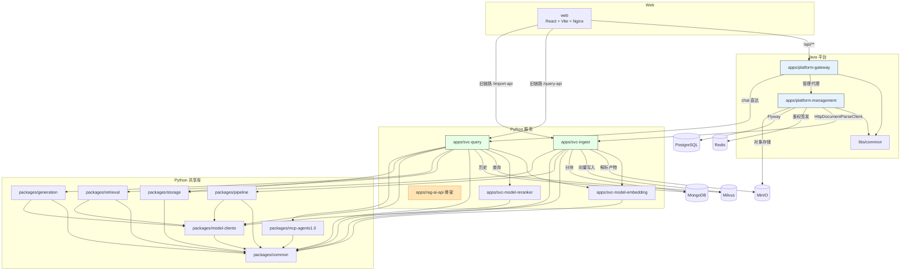

# 应用架构

> 事实源：`pymodules/pyproject.toml`、`javaplat/pom.xml`、`deploy/docker/docker-compose-{base,models,python,java,yaml}.yaml`、`javaplat/apps/*/src/main/resources/application.yml`、`web/nginx.conf.template`。

---

## 应用清单

### apps/platform-gateway（Java 21 / Spring Boot 3.4）

| 项 | 值 |
| --- | --- |
| 仓库 | `javaplat/apps/platform-gateway/` |
| 运行时 | Java 21 · Spring Boot 3.4.1 |
| 容器内端口 | 8080 |
| 宿主映射端口 | `PLATFORM_GATEWAY_PORT`（默认 8081） |
| multipart 解析 | **enabled=false**（流式转发，不提前消费请求体） |
| 状态 | ✅ 已实现 |
| 依赖 | Redis（健康 + JWT 验证密钥）、platform-management（健康）、svc-query（健康，chat 链路） |

**职责**：

- 统一入口（前端 `/api/**` 全部打到这里）
- JWT 验签、JTI 撤销校验、用户安全快照（`SecurityPrincipal`）
- 身份头重建：`X-User-Id`、`X-Tenant-Id`、`X-Roles`、`X-Permissions`、`X-Kb-Ids`
- 管理请求代理：`/api/v1/**` → `platform-management:8080`（`ManagementProxyController`）
- Chat 直达代理：`/api/v1/chat`、`/api/v1/chat/stream` → `svc-query:8002`（`ChatController`）
- 流式 SSE 透传：`StreamingResponseBody` + `compliance.relay(input, output)` 输出合规
- 幂等（`Idempotency-Key`，24h）、限流、审计事件发布（`GatewayAuditService`）
- 输入安全（`GatewayContentSecurityService`）、输出合规（`OutputComplianceGuard`）
- Prometheus 指标 + Trace 贯通（`TracingService`）

**不承担**：认证签发（management 负责）、文档解析、向量计算、Prompt 生成。

### apps/platform-management（Java 21 / Spring Boot 3.4）

| 项 | 值 |
| --- | --- |
| 仓库 | `javaplat/apps/platform-management/` |
| 运行时 | Java 21 · Spring Boot 3.4.1 + Flyway + Resilience4j |
| 容器内端口 | 8080 |
| 宿主端口 | **无**（仅 `expose: 8080`，容器网络内可见） |
| 状态 | ✅ 已实现 |
| 依赖 | PostgreSQL（Flyway 迁移）、Redis（健康）、MinIO（健康）、svc-ingest（健康） |

**职责**：

- 认证：bcrypt 校验 + JWT accessToken（30min）/ refreshToken（7d）、登录失败计数与锁定（`sec_users.failed_attempts` / `locked_until`）
- RBAC：角色、权限点、角色-权限、角色-知识库授权、用户-角色（V1__security_baseline.sql）
- 知识库 / 文档：创建、查询、删除、软删除、文件哈希去重、状态机（V3）
- 导入任务：状态机 QUEUED → RUNNING → DONE / FAILED / CANCELED、重试（V5）
- 审计落库：`sec_audit_logs` 链式哈希、审计保留 180 天定时清理
- 内容安全：`sec_policies` / `sec_rules` 规则引擎（ContentSecurityService）
- 导出：异步 `export_jobs`（V7）、对象存储 + AES-GCM、TTL 24h
- 索引导出：`vector_index_builds` HNSW 构建记录（V6）
- 系统配置：`SystemConfigRepository`
- 请求日志：`request_logs` 结构化记录（V8、V9）

**不承担**：对外暴露 HTTP（宿主机不可直连）、chat 主链路中转（chat 直达 svc-query）。

### apps/svc-query（Python 3.12 / FastAPI + LangGraph）

| 项 | 值 |
| --- | --- |
| 仓库 | `pymodules/apps/query-worker/` |
| 运行时 | Python 3.12 · FastAPI 0.142 · LangGraph 1.2 · LangChain 1.4 |
| 默认端口 | `QUERY_WORKER_PORT`（默认 8002） |
| 状态 | ✅ 已实现 |
| 依赖 | svc-model-embedding（健康）、svc-model-reranker（健康）、Milvus（健康）、MinIO（健康）、MongoDB |
| 共享库依赖 | common、generation、model-clients、retrieval、storage、mcp-agents1.0 |

**路由**（`query_worker/api/routers/`）：

| 路由 | 方法 | 说明 |
| --- | --- | --- |
| `/health` | GET | 健康检查 |
| `/query` | POST | 知识库查询（非流式或触发后台流式） |
| `/stream/{session_id}` | GET | SSE 订阅（`text/event-stream`） |
| `/api/v1/chat` | POST | P0 契约 chat 入口（被 gateway ChatController 调用） |
| `/api/v1/chat/stream` | POST | P0 契约 SSE chat 入口 |
| `/api/v1/retrieval/*` | GET/POST | 检索调试 |
| `/api/v1/history` | GET | 会话历史 |
| `/api/v1/generation/*` | GET/POST | 生成调试 |

### apps/svc-ingest（Python 3.12 / FastAPI + LangGraph）

| 项 | 值 |
| --- | --- |
| 仓库 | `pymodules/apps/ingest-worker/` |
| 运行时 | Python 3.12 · FastAPI 0.142 · LangGraph 1.2 · LangChain 1.4 |
| 默认端口 | `INGEST_WORKER_PORT`（默认 8001） |
| 状态 | ✅ 已实现 |
| 依赖 | svc-model-embedding（健康）、svc-model-reranker（健康）、Milvus（健康）、MinIO（健康）、MongoDB |
| 共享库依赖 | common、model-clients、pipeline、retrieval、storage |

**路由**（`ingest_worker/api/routers/`）：

| 路由 | 方法 | 说明 |
| --- | --- | --- |
| `/api/v1/documents/{document_id}:parse` | POST | 文档解析（MinerU / 清洗 / 分块 / 向量化） |
| `/api/v1/tasks` | GET | 任务状态查询 |
| `/api/v1/metadata` | GET | 元数据查询 |
| `/api/v1/pages` | GET | 页面查询 |
| `/api/v1/embedding` | POST | 嵌入 |
| `/api/v1/summary` | POST | 摘要 |

### apps/svc-model-embedding（Python 3.12 / FastAPI + Torch）

| 项 | 值 |
| --- | --- |
| 仓库 | `pymodules/apps/model-embedding-worker/` |
| 运行时 | Python 3.12 · FastAPI · Torch 2.11（cpu 或 cuda128）· BGE-M3 |
| 默认端口 | `MODEL_EMBEDDING_WORKER_PORT`（默认 8003） |
| 状态 | ✅ 已实现 |
| 依赖 | 模型目录 `MODEL_BASE_DIR/bge-m3` |

**路由**：`/health`、`/v1/embeddings`。

### apps/svc-model-reranker（Python 3.12 / FastAPI + Torch）

| 项 | 值 |
| --- | --- |
| 仓库 | `pymodules/apps/model-reranker-worker/` |
| 运行时 | Python 3.12 · FastAPI · Torch 2.11 · BGE-Reranker-Large |
| 默认端口 | `MODEL_RERANKER_WORKER_PORT`（默认 8004） |
| 状态 | ✅ 已实现（开发全量链路使用） |
| 依赖 | 模型目录 `MODEL_BASE_DIR/bge-reranker-large` |

**路由**：`/health`、`/v1/rerank`。

### apps/rag-ai-api（Python 3.12 / FastAPI）

| 项 | 值 |
| --- | --- |
| 仓库 | `pymodules/apps/rag-ai-api/` |
| 运行时 | Python 3.12 · FastAPI |
| 端口 | **固定 8100**（容器内） |
| 状态 | ⚠️ **骨架**（P0 契约占位） |

**已实现路由**：`/healthz`、`/readyz`、`/metrics`（Prometheus）、`/api/v1/system/info`。

**统一 501 回退**：所有其他 `/api/v1/**` 返回 `{code: "SYS.NOT_IMPLEMENTED", ...}` 保持契约信封。

**说明**：`docker-compose-p0.yaml` 中 rag-ai-api 同时暴露给 chat 链路；在全量五级编排（`docker-compose.yaml`）中，chat 主链路改为直达 `svc-query`，rag-ai-api 仅保留契约占位。

### web（React 18 + Vite 5 + Nginx）

| 项 | 值 |
| --- | --- |
| 仓库 | `web/` |
| 运行时 | React 18.3.1 · React Router 6.26 · Vite 5.4 · Nginx（容器） |
| 容器内端口 | 80（HTTP）/ 443（HTTPS） |
| 宿主映射 | `FRONTEND_PORT` 默认 80，`FRONTEND_HTTPS_PORT` 默认 443 |
| 默认入口 | **HTTPS 443**（HTTP 80 → 308 https 重定向） |
| 状态 | ✅ 已实现 |

**反代规则**（`web/nginx.conf.template`）：

| location | 上游 | 说明 |
| --- | --- | --- |
| `/api/**` | `PLATFORM_API_UPSTREAM` → platform-gateway:8080 | P0 主链路，带 `Authorization`、`Idempotency-Key`、`proxy_buffering off` |
| `/query-api/**` | `QUERY_API_UPSTREAM` → svc-query:8002 | 旧链路保留直连 Python |
| `/import-api/**` | `IMPORT_API_UPSTREAM` → svc-ingest:8001 | 旧链路保留直连 Python |
| `/healthz`、`/readyz` | Nginx 内置 | 200 静态 |

---

## 共享库清单

### pymodules/packages/*

| 包 | 仓库 | 职责 |
| --- | --- | --- |
| aipaas-common | `packages/common/` | 配置（Settings）、日志、上下文、SSE 工具、限流、可观测、后台任务 |
| aipaas-pipeline | `packages/pipeline/` | 解析器注册、清洗、分块、向量化、HNSW 索引、存储 |
| aipaas-retrieval | `packages/retrieval/` | 查询归一、向量召回、权限过滤、Milvus 工具、审计 |
| aipaas-generation | `packages/generation/` | Prompt 模板、LLM 客户端、引用、拒答、输出校验、格式化 |
| aipaas-model-clients | `packages/model-clients/` | HTTP 客户端（Embedding / Reranker / LLM） |
| aipaas-storage | `packages/storage/` | MinIO 工具、Mongo 历史、Kubernetes 客户端 |
| aipaas-mcp-agents1.0 | `packages/mcp-agents1.0/` | MCP 客户端（mcp<2 + openai-agents<0.20.0，query-worker 使用） |
| aipaas-mcp-agents2.0 | `packages/mcp-agents2.0/` | MCP v2 客户端（独立管理，暂未被任何成员依赖） |
| aipaas-nacos | `packages/nacos/` | Nacos 注册中心客户端（可选 profile） |

### javaplat/libs/common/

| 项 | 说明 |
| --- | --- |
| 职责 | 统一响应信封、错误码、Trace 上下文、安全主体验证（SecurityPrincipal）、通用中间件 |
| 依赖方向 | apps/platform-gateway、apps/platform-management 均可依赖 common；common 不反向依赖任何 app |

### 依赖方向约束

- **apps → packages** 单向：`svc-ingest`/`svc-query`/`svc-model-*` 依赖 packages/*，packages 不得反向 import apps 模块
- **apps/gateway → libs/common** 单向，**apps/management → libs/common** 单向
- **gateway ↔ management**：通过 HTTP 互相调用，无直接代码依赖
- **gateway → svc-query**：通过 HTTP 调用 chat 链路
- **management → svc-ingest**：通过 HTTP 调用解析链路

---

## 单向依赖方向图

---

## 模块状态矩阵

| 模块 | 类型 | 已实现 | 骨架 | 规划 | 备注 |
| --- | --- | --- | --- | --- | --- |
| platform-gateway | Java Spring Boot 应用 | ✅ | | | 统一入口、SSE 流式透传、identity header 重建 |
| platform-management | Java Spring Boot 应用 | ✅ | | | Flyway V1~V9、RBAC、审计链式哈希、导出 |
| platform-db-init | Java 一次性容器 | ✅ | | | psql CREATE DATABASE（幂等） |
| svc-ingest | Python FastAPI + LangGraph | ✅ | | | ParseOptions、MinerU、分块策略、Embedding 写入 |
| svc-query | Python FastAPI + LangGraph | ✅ | | | Query/SSE/RAG 流程、引用/拒答、MCP 预留 |
| svc-model-embedding | Python FastAPI | ✅ | | | BGE-M3 dense+sparse |
| svc-model-reranker | Python FastAPI | ✅ | | | BGE-Reranker-Large |
| rag-ai-api | Python FastAPI | | ✅ | | 501 骨架，仅 /healthz /readyz /api/v1/system/info |
| frontend | React + Vite + Nginx | ✅ | | | HTTPS 443 默认入口 /api/** → gateway |
| aipaas-common | Python 共享库 | ✅ | | | |
| aipaas-pipeline | Python 共享库 | ✅ | | | |
| aipaas-retrieval | Python 共享库 | ✅ | | | |
| aipaas-generation | Python 共享库 | ✅ | | | |
| aipaas-model-clients | Python 共享库 | ✅ | | | |
| aipaas-storage | Python 共享库 | ✅ | | | |
| aipaas-mcp-agents1.0 | Python 共享库 | ✅ | | | query-worker 使用 |
| aipaas-mcp-agents2.0 | Python 共享库 | ✅ | | | 独立管理，暂未被依赖 |
| aipaas-nacos | Python 共享库 | ✅ | | | 可选 profile |
| javaplat/libs/common | Java 共享库 | ✅ | | | 统一信封、Trace、SecurityPrincipal |
| aipaas-contracts | OpenAPI 契约 + mock | ✅ | | | 冻结版 1.1.0-p0、70 path / 80 operation |
| vllm | profile: vllm | | | ✅ | Qwen3-0.6B（需 GPU） |
| nacos | profile: nacos | | | ✅ | 注册/配置中心 |
| rocketmq | profile: rocketmq | | | ✅ | 消息队列 |
| BM25 召回 | — | | | ✅ | P1 |
| Cross-Encoder 重排 | — | | | ✅ | P1 |
| SSO / MFA / OAuth | — | | | ✅ | |
| 多租户管理界面 | — | | | ✅ | tenant_id 字段已预留 |
| 分布式全局限流 | — | | | ✅ | Resilience4j 目前单实例 |
| OpenTelemetry Collector | — | | | ✅ | TraceId 贯通但未接 Collector |
