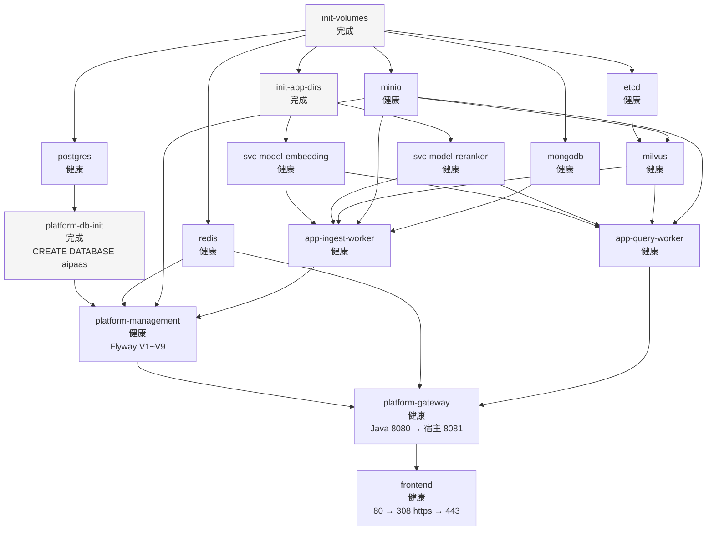
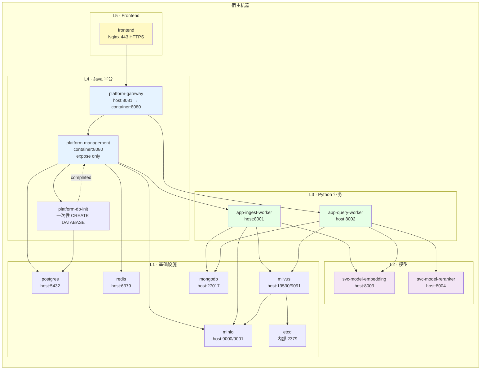

# 部署架构

> 事实源：`deploy/docker/docker-compose.yaml`、`docker-compose-java.yaml`、`docker-compose-python.yaml`、`docker-compose-models.yaml`、`docker-compose-base.yaml`、`docker-compose-p0.yaml`、`.env.example`。

---

## 五级 Compose 编排

每一级都可独立作为启动入口，自动拉起其下所有层级：

```text
docker-compose.yaml       （第 5 级 · frontend）
  └─ include docker-compose-java.yaml          （第 4 级 · Java 平台）
        └─ include docker-compose-python.yaml  （第 3 级 · Python 业务）
              └─ include docker-compose-models.yaml  （第 2 级 · 模型服务）
                    └─ include docker-compose-base.yaml  （第 1 级 · 基础设施）
```

**启动**：
```bash
# 全量启动（最常用）
cd deploy/docker && docker compose up -d --build

# 只起前 3 级（Python 链路 + 模型 + 中间件，不带 Java 平台）
docker compose -f docker-compose-python.yaml up -d --build

# 只起基础设施 + 可选 attu（查看 Milvus）
docker compose -f docker-compose-base.yaml --profile attu up -d
```

---

### L1 base — 基础设施

| 服务 | 类型 | 镜像 | 核心端口（宿主） | 持久化卷 | profile |
| --- | --- | --- | --- | --- | --- |
| init-volumes | 一次性初始化 | alpine | — | `${DOCKER_VOLUME_DIRECTORY}/volumes` | — |
| **etcd** | Milvus 元数据 | `quay.io/coreos/etcd:v3.5.25` | 2379（容器内，不对外） | `${DOCKER_VOLUME_DIRECTORY}/volumes/etcd` | — |
| **minio** | 对象存储 | `minio/minio:RELEASE.2025-09-07T16-13-09Z-cpuv1` | 9000 / 9001 | `${DOCKER_VOLUME_DIRECTORY}/volumes/minio` | — |
| **milvus** | 向量检索 | `milvusdb/milvus:v3.0.1` | 19530 / 9091 | `${DOCKER_VOLUME_DIRECTORY}/volumes/milvus-data` | — |
| **mongodb** | 文档存储 | `amd64/mongo:8.0` | 27017 | `${DOCKER_VOLUME_DIRECTORY}/volumes/mongo/{data,config}` | — |
| **postgres** | 关系库 + pgvector | `pgvector/pgvector:pg17` | 5432 | 命名卷 `pg-data`（挂载到 `/var/lib/postgresql/data`） | — |
| **redis** | 缓存 | `redis:7-alpine` | 6379 | 命名卷 `redis-data` | — |
| attu | Milvus UI | `zilliz/attu:v3.0.0` | 3000 | `${DOCKER_VOLUME_DIRECTORY}/volumes/attu-data` | `attu` |
| nacos | 注册/配置中心 | `nacos/nacos-server:v3.3.0` | 8848 / 9848 / 8080 | 命名卷 `nacos-data` | `nacos` |
| rocketmq-namesrv | MQ NameServer | `apache/rocketmq:5.3.1` | 9876 | 命名卷 `rocketmq-namesrv-data` | `rocketmq` |
| rocketmq-broker | MQ Broker | `apache/rocketmq:5.3.1` | 10911 / 10909 | 命名卷 `rocketmq-broker-data` | `rocketmq` |
| vllm | LLM 推理 | `vllm/vllm-openai:v0.11.0` | 8008 | `${VLLM_MODEL_DIR}` ro（模型目录） | `vllm` |

**依赖**：milvus → etcd + minio；nacos → postgres（healthy）；rocketmq-broker → rocketmq-namesrv（healthy）；全部核心组件依赖 init-volumes（completed_successfully）。

---

### L2 models — 模型服务

| 服务 | 构建上下文 | Dockerfile | 宿主端口 | 依赖（healthy） |
| --- | --- | --- | --- | --- |
| init-app-dirs | alpine（一次性） | — | — | — |
| **svc-model-embedding** | `../../pymodules` | `apps/model-embedding-worker/Dockerfile` | `MODEL_EMBEDDING_WORKER_PORT` 默认 8003 | init-app-dirs |
| **svc-model-reranker** | `../../pymodules` | `apps/model-reranker-worker/Dockerfile` | `MODEL_RERANKER_WORKER_PORT` 默认 8004 | init-app-dirs |

**关键挂载**：`CONFIG_PACKAGE_DIR` → `/app/configs:ro`（Python 配置包）；`MODEL_BASE_DIR/bge-m3`、`MODEL_BASE_DIR/bge-reranker-large` → 容器内模型路径（ro）；DOCKER_LOG_DIRECTORY/logs/svc-*。

**资源限制**：cpu 4 / memory 4G，reservations cpu 1 / memory 1G（GPU 场景另加 devices driver nvidia）。

---

### L3 python — Python 业务

| 服务 | 构建上下文 | 宿主端口 | 依赖（healthy） |
| --- | --- | --- | --- |
| **app-ingest-worker** | `../../pymodules` | `APP_INGEST_WORKER_PORT` 默认 8001 | svc-model-embedding、svc-model-reranker、milvus、minio、mongodb；（可选 nacos） |
| **app-query-worker** | `../../pymodules` | `APP_QUERY_WORKER_PORT` 默认 8002 | svc-model-embedding、svc-model-reranker、milvus、minio；（可选 nacos） |

**资源限制**：cpu 1 / memory 1G，reservations cpu 0.1 / memory 256M。

---

### L4 java — Java 平台

| 服务 | 构建上下文 | expose | 宿主端口 | 依赖（healthy） |
| --- | --- | --- | --- | --- |
| platform-db-init | `pgvector/pgvector:pg17` 一次性 | — | — | postgres |
| **platform-management** | `../../javaplat` | 8080（仅容器网络） | 无 | platform-db-init（completed）、redis、minio、app-ingest-worker |
| **platform-gateway** | `../../javaplat` | — | `PLATFORM_GATEWAY_PORT` 默认 **8081** | platform-management、redis、app-query-worker |

**关键挂载**：
- platform-security-keys（密钥环）、platform-upload-temp（上传临时）、platform-request-logs（请求日志落盘）、platform-jwt-verify（JWT 验证密钥导出）
- platform-tls（证书，只读挂载到 management；frontend 也使用此卷）
- platform-gateway 只挂载 platform-jwt-verify（ro）；**不挂载**业务数据/MinIO/AES 密钥

**资源限制**：management cpu 1 / 1G；gateway cpu 0.5 / 512M。

---

### L5 frontend — Web 前端

| 服务 | 构建上下文 | 宿主端口 | 依赖（healthy） |
| --- | --- | --- | --- |
| **frontend** | `../../web` | `FRONTEND_PORT` 默认 80、`FRONTEND_HTTPS_PORT` 默认 **443** | platform-gateway |

**资源限制**：cpu 0.5 / 128M（reservations 0.05 / 32M）。

---

## 启动依赖链



**等价时序**：
```
init-volumes → etcd/minio/postgres/redis/mongodb healthy
→ milvus healthy
→ init-app-dirs → svc-model-embedding / svc-model-reranker healthy
→ app-ingest-worker / app-query-worker healthy
→ postgres healthy → platform-db-init completed
→ redis/minio/app-ingest-worker healthy → platform-management healthy
→ platform-management + redis + app-query-worker healthy → platform-gateway healthy
→ platform-gateway healthy → frontend healthy
```

---

## 关键环境变量（来自 .env.example）

| 变量 | 默认 | 说明 |
| --- | --- | --- |
| `PLATFORM_GATEWAY_PORT` | **8081** | 宿主映射 port；gateway 容器内固定 8080 |
| `PLATFORM_DB` | `aipaas` | Java 平台独立数据库（postgres 共用实例内） |
| `PLATFORM_MINIO_BUCKET` | `aipaas` | Java 平台 MinIO bucket |
| `PLATFORM_BOOTSTRAP_ADMIN_PASSWORD` | 必填 | 首次启动初始化 admin 账号；12–128 位含大小写/数字/特殊字符 |
| `FRONTEND_HTTPS_PORT` | **443** | 前端 HTTPS 宿主入口 |
| `FRONTEND_PORT` | 80 | HTTP 宿主入口（308 → HTTPS） |
| `MODEL_BASE_DIR` | `/coding/models/BAAI` | 宿主机模型根目录，需含 bge-m3、bge-reranker-large |
| `CONFIG_PACKAGE_DIR` | `../../pymodules/configs` | Python 配置包挂载源 |
| `APP_QUERY_WORKER_PORT` | **8002** | app-query-worker 默认 |
| `APP_INGEST_WORKER_PORT` | **8001** | app-ingest-worker 默认 |
| `MODEL_EMBEDDING_WORKER_PORT` | **8003** | 嵌入服务默认 |
| `MODEL_RERANKER_WORKER_PORT` | **8004** | 重排序服务默认 |
| `TLS_GENERATE_SELF_SIGNED` | true | 开发自动生成 30 天自签证书 |
| `TLS_SERVER_NAME` | localhost | 证书 CN |
| `REDIS_PASSWORD` | 空 | Redis 密码（默认无密码） |
| `MINIO_ACCESS_KEY` / `MINIO_SECRET_KEY` | minioadmin | MinIO 管理员账密 |
| `POSTGRES_USER` / `POSTGRES_PASSWORD` / `POSTGRES_DB` | nacos / nacos / nacos | PostgreSQL 共用实例（Nacos + Java 平台） |
| `IMAGE_TAG` | latest | 镜像 tag；发布时改成版本号 |
| `TORCH_VARIANT` | cpu | svc-model-* 构建变体（cpu / gpu） |
| `COMPOSE_PROFILES` | attu | 可选 profile 组合 |

---

## Compose include 链与 profile 优先级

### Include 链

```yaml
# docker-compose.yaml
include: [docker-compose-java.yaml]

# docker-compose-java.yaml
include: [docker-compose-python.yaml]

# docker-compose-python.yaml
include: [docker-compose-models.yaml]

# docker-compose-models.yaml
include: [docker-compose-base.yaml]
```

### Profile

| Profile | 加载服务 | 默认？ |
| --- | --- | --- |
| （无核心 profile） | etcd/minio/milvus/mongodb/postgres/redis、所有 Python/Java/frontend | ✅ |
| `attu` | + attu（Milvus UI 3000） | ✅ `.env.example` 默认启用 |
| `nacos` | + nacos（复用核心 postgres 实例 5432） | ❌ |
| `rocketmq` | + rocketmq-namesrv / broker | ❌ |
| `vllm` | + vllm:8008（需 NVIDIA GPU） | ❌ |
| `observability` | + prometheus / alertmanager / grafana | ❌（docker-compose-p0.yaml 内置） |

**优先级（高→低）**：shell 导出的环境变量 > `.env` 文件 > compose 内置默认值。

命令行强制覆盖 profile：
```bash
COMPOSE_PROFILES=nacos,vllm docker compose up -d --build
# 或
docker compose --profile nacos --profile vllm up -d --build
```

---

## 网络与卷

### 网络

| 网络 | 驱动 | 说明 |
| --- | --- | --- |
| `aipaas-network` | bridge（Compose 默认） | 全部五级服务共用；服务间通过 `container_name` 互相解析 |

### 命名卷

| 卷 | 归属 | 写入者 | 读取者 |
| --- | --- | --- | --- |
| `pg-data` | PostgreSQL | postgres | postgres |
| `redis-data` | Redis | redis | redis |
| `nacos-data` | Nacos（profile） | nacos | nacos |
| `rocketmq-namesrv-data` | RocketMQ（profile） | rocketmq-namesrv | rocketmq-namesrv |
| `rocketmq-broker-data` | RocketMQ（profile） | rocketmq-broker | rocketmq-broker |
| `platform-security-keys` | 密钥环 | platform-management | platform-management |
| `platform-upload-temp` | 上传临时 | platform-management | platform-management |
| `platform-request-logs` | 请求日志落盘 | platform-management | platform-management |
| **`platform-jwt-verify`** | JWT 验证密钥 | platform-management（rw） | platform-gateway（ro） |
| **`platform-tls`** | TLS 证书 | frontend（开发自动生成）、management | frontend、management |

**说明**：除 pg-data/redis-data 等核心中间件外，Java 平台相关卷在 **L4** 才被创建（`docker-compose-java.yaml` 的 `volumes:` 块）。

---

## 部署拓扑图



---

## 端口总表

### 五级编排

| 服务 | 宿主端口 | 容器内端口 | 协议 | 说明 |
| --- | --- | --- | --- | --- |
| **frontend** | **443** | 443 | HTTPS | 默认入口 |
| frontend | 80 | 80 | HTTP | 308 → HTTPS |
| **platform-gateway** | **8081** | 8080 | HTTP | Java 唯一宿主入口 |
| **app-ingest-worker** | 8001 | 8001 | HTTP | Python 导入 |
| **app-query-worker** | 8002 | 8002 | HTTP | Python 查询 |
| **svc-model-embedding** | 8003 | 8003 | HTTP | 嵌入 |
| **svc-model-reranker** | 8004 | 8004 | HTTP | 重排序 |
| **postgres** | **5432** | 5432 | TCP | pgvector 实例（Nacos + Java 平台共用） |
| **redis** | **6379** | 6379 | TCP | 缓存/会话 |
| **minio** | **9000** | 9000 | TCP | 对象存储 S3 API |
| minio | 9001 | 9001 | HTTP | MinIO Console |
| **milvus** | **19530** | 19530 | TCP | Milvus gRPC |
| milvus | 9091 | 9091 | HTTP | Milvus REST |
| **mongodb** | **27017** | 27017 | TCP | 文档存储 |
| etcd | — | 2379 | TCP | 内部（Milvus 元数据） |
| attu（profile） | 3000 | 3000 | HTTP | Milvus 管理 UI |
| nacos（profile） | 8848 / 9848 / 8080 | 8848 | HTTP/gRPC | 注册/配置中心 |
| rocketmq-namesrv（profile） | 9876 | 9876 | TCP | NameServer |
| rocketmq-broker（profile） | 10911 / 10909 | 10911 | TCP | Broker |
| vllm（profile） | 8008 | 8000 | HTTP | LLM 推理 |

### P0 独立编排（docker-compose-p0.yaml）

避开宿主机已占用端口的 **P0 专用端口**：

| 服务 | 宿主端口 | 容器内端口 | 说明 |
| --- | --- | --- | --- |
| postgres | — | 5432 | 仅容器内可见 |
| redis | **56379** | 6379 | |
| minio | **19000 / 19001** | 9000 / 9001 | |
| milvus | **29530 / 29091** | 19530 / 9091 | |
| platform-gateway | （expose only） | 8080 | P0 编排中 gateway 不向宿主开放 |
| platform-management | — | 8080 | |
| mock | **4010** | 4010 | 契约 mock |
| web | **18080 / 18443** | 80 / 443 | |
| prometheus | **19090** | 9090 | |
| alertmanager | **19093** | 9093 | |
| grafana | **13000** | 3000 | |

---

## 独立 P0 Compose（docker-compose-p0.yaml）的边界

### 用途

`docker-compose-p0.yaml` 是**单文件扁平编排**（无 include 链），包含 P0 验收所需的最小闭环：

- 基础设施：postgres / redis / minio / etcd+milvus / prometheus / alertmanager / grafana
- 应用骨架：platform-gateway + platform-management（Java）+ app-ingest-worker / app-query-worker（Python）+ web（React）+ mock（契约）
- **避开**宿主机已占用端口（见上节 P0 专用端口表）

### 与五级编排的差异

| 项 | 五级编排（docker-compose.yaml） | P0 独立编排（docker-compose-p0.yaml） |
| --- | --- | --- |
| include 链 | 五级递进 include | 无 include，全部平铺在一个文件 |
| 宿主端口 | 标准（8081/8001/8002…） | 避让（8081/56379/19000…） |
| 可观测 | profile: observability | 内置 prometheus / alertmanager / grafana |
| Nacos / RocketMQ / vLLM | profile 可选 | **无** |
| attu | profile: attu | **无** |
| mock | 不在五级编排中 | 内置（4010） |
| redis 密码 | 默认空（appendonly yes） | `--maxmemory 512mb --maxmemory-policy allkeys-lru` |
| 用途 | **开发 + 生产** | **P0 验收 + 隔离测试** |
