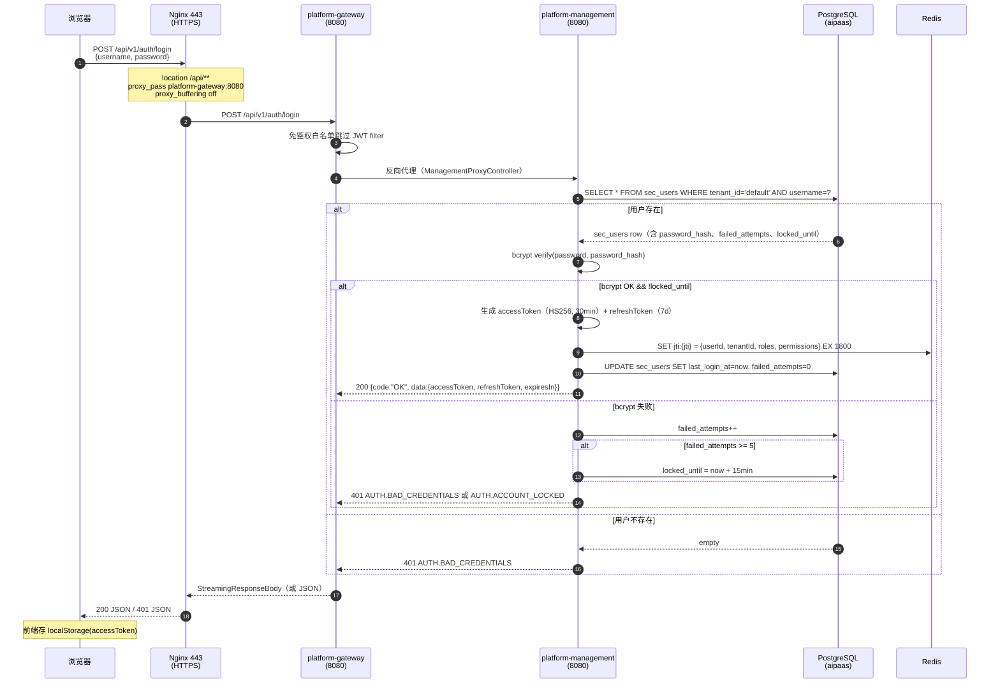

# 调用链路

> 事实源：`javaplat/apps/platform-gateway/.../ChatController.java`、`ManagementProxyController.java`、`javaplat/apps/platform-management/.../auth/AuthController.java`、`javaplat/apps/platform-management/.../document/DocumentController.java`、`javaplat/apps/platform-management/.../application.yml`、`pymodules/apps/ingest-worker/ingest_worker/api/routers/parse.py`、`pymodules/apps/query-worker/query_worker/api/routers/{query,stream}.py`、`aipaas-contracts/openapi/aipaas-openapi-v1.yaml`。

---

## 链路一：登录



---

## 链路二：文件上传 + 异步解析

> **关键点**：gateway multipart.enabled=false（`application.yml`），请求体流式透传给 management，**不**在 gateway 被提前解析。

```mermaid
sequenceDiagram
    autonumber
    participant Browser as 浏览器
    participant Nginx as Nginx 443<br/>(HTTPS)
    participant Gateway as platform-gateway<br/>(8080)<br/>multipart.enabled=false
    participant Management as platform-management<br/>(8080)
    participant MinIO as MinIO<br/>(9000)
    participant Ingest as svc-ingest<br/>(8001)
    participant ModelEB as svc-model-embedding<br/>(8003)
    participant Milvus as Milvus<br/>(19530)
    participant PG as PostgreSQL<br/>(aipaas)
    participant Mongo as MongoDB

    Browser->>Nginx: POST /api/v1/knowledge-bases/{kbId}/documents<br/>multipart/form-data<br/>{Idempotency-Key: uuid}
    Note over Nginx: location /api/**<br/>proxy_pass platform-gateway:8080<br/>proxy_buffering off<br/>client_max_body_size 200m
    Nginx->>Gateway: POST /api/v1/knowledge-bases/{kbId}/documents
    Note over Gateway: multipart.enabled=false<br/>请求体未被 Spring 解析<br/>直接 InputStream 转发
    Gateway->>Gateway: JWT 验签 + chat:use 权限 + Idempotency-Key 幂等检查
    Gateway->>Management: 流式代理 multipart body<br/>（ManagementProxyController InputStream 直通）
    Management->>Management: 验签 doc:upload 权限<br/>对象归属（role_kb_grants）<br/>文件哈希（SHA-256）校验
    Management->>PG: INSERT documents（tenant_id, kb_id, filename_ciphertext, file_hash, object_key, status=UPLOADED）
    Management->>MinIO: PUT {kbId}/{docId}.{ext}
    MinIO-->>Management: 200 ETag
    Management->>PG: INSERT ingest_tasks（status=QUEUED, stage=PARSE）
    Management-->>Gateway: 202 {code:"OK", data:{taskId, documentId, status:"QUEUED"}}

    rect rgb(240, 240, 240)
        Note over Management,Ingest: **异步** HttpDocumentParseClient 触发
        Management->>Ingest: POST /api/v1/documents/{documentId}:parse<br/>（带 documentId、tenantId、chunkStrategy 等）
        Ingest->>MinIO: GET 原始文件
        MinIO-->>Ingest: 字节流
        Ingest->>Ingest: MinerU 解析 → 清洗 → 分块<br/>（ParseOptions / CleaningOptions / ChunkConfig）
        Ingest->>ModelEB: POST /v1/embeddings<br/>dense 1024 + sparse
        ModelEB-->>Ingest: 嵌入向量
        Ingest->>Milvus: INSERT（HNSW, COSINE, M=16, efConstruction=200, dimension=1024）
        Ingest->>Mongo: chunk 明细、解析中间产物
        Ingest->>MinIO: PUT parse-results/v1.json（版本化产物）
        Ingest->>Management: 任务状态回调 DONE
        Management->>PG: UPDATE ingest_tasks SET status=DONE, finished_at=now
        Management->>PG: INSERT document_parse_results (version=1)
        Management->>Milvus: 触发 VectorIndexBuild → HNSW 构建 → 新 READY 后 alias 热切换
    end

    Gateway-->>Nginx: 返回 202
    Nginx-->>Browser: 返回 202 {taskId}
    Browser->>Nginx: GET /api/v1/ingest/tasks/{taskId} 轮询
    Nginx->>Gateway: 代理到 management
    Gateway->>Management: 查询 ingest_tasks 状态
    Management-->>Gateway: {status:"DONE", chunkCount:N}
    Gateway-->>Nginx-->>Browser: 200 DONE
```

---

## 链路三：用户查询（**gateway → svc-query 直达，不经过 management**）

```mermaid
sequenceDiagram
    autonumber
    participant Browser as 浏览器
    participant Nginx as Nginx 443<br/>(HTTPS)
    participant Gateway as platform-gateway<br/>(8080)
    participant Query as svc-query<br/>(8002)
    participant ModelEB as svc-model-embedding<br/>(8003)
    participant ModelRR as svc-model-reranker<br/>(8004)
    participant Milvus as Milvus<br/>(19530)
    participant LLM as 在线 LLM

    Browser->>Nginx: POST /api/v1/chat<br/>{query:"...", kbIds:[...], capability:"RAG"}<br/>{Idempotency-Key: uuid}
    Note over Nginx: location /api/** → platform-gateway:8080
    Nginx->>Gateway: POST /api/v1/chat
    Gateway->>Gateway: JWT 验签 + chat:use 权限 + 幂等 + 输入安全（GatewayContentSecurityService）
    Gateway->>Gateway: 重建 identity headers<br/>X-User-Id, X-Tenant-Id, X-Roles, X-Permissions, X-Kb-Ids
    Gateway->>Query: **直达** POST /api/v1/chat<br/>（ChatController 使用 aipaas.chat.service-url）<br/>带 traceparent + Idempotency-Key
    Note over Gateway,Query: ⚠️ **不经过 platform-management**

    Query->>Query: LangGraph entry → item_name_confirm（产品/条款号识别）
    
    par 向量召回
        Query->>ModelEB: /v1/embeddings（HyDE + query 改写）
        ModelEB-->>Query: dense+sparse
        Query->>Milvus: search（COSINE, topK=100, filter=kbIds）
        Milvus-->>Query: chunk candidates
    and MCP 联网搜索（可选）
        Query->>Query: mcp_agent1（未被 P0 实际调用）
    end

    Query->>ModelRR: /v1/rerank（Cosine 粗排后精排）
    ModelRR-->>Query: reranked topK=10
    Query->>LLM: generate（含引用 / 拒答规则 / item_name_confirm）
    LLM-->>Query: answer with citations

    Query-->>Gateway: 200 JSON（non-stream）或 SSE text/event-stream（stream）
    
    Note over Gateway: 输出合规（OutputComplianceGuard）<br/>审计（GatewayAuditService）<br/>SSE 时 StreamingResponseBody relay 透传
    Gateway-->>Nginx: 200 JSON / SSE stream
    Nginx-->>Browser: 200 JSON / text/event-stream

    rect rgb(240, 255, 240)
        Note over Browser,Gateway: **SSE 流式变体**：POST /api/v1/chat/stream
        Browser->>Nginx->>Gateway: POST /api/v1/chat/stream
        Gateway->>Query: POST /api/v1/chat/stream（SSE accept header）
        Query-->>Gateway: SSE stream
        Gateway->>Gateway: compliance.relay(input, output, traceId)<br/>透传 SSE event: delta/citation/done/error/ping
        Gateway-->>Nginx-->>Browser: text/event-stream
    end
```

---

## 链路四：管理类请求（gateway → management）

> 对比查询链路：chat 直达 svc-query，管理类走 management。

```mermaid
sequenceDiagram
    autonumber
    participant Browser as 浏览器
    participant Nginx as Nginx 443
    participant Gateway as platform-gateway
    participant Management as platform-management
    participant PG as PostgreSQL
    participant Redis as Redis
    participant MinIO as MinIO

    Browser->>Nginx: POST /api/v1/knowledge-bases<br/>{tenantId, name, domain}
    Nginx->>Gateway: POST /api/v1/knowledge-bases
    Gateway->>Gateway: JWT 验签 + kb:create 权限 + 幂等 + 身份头重建
    Gateway->>Management: ManagementProxyController 流式代理

    Management->>PG: INSERT knowledge_bases
    Management->>Redis: SET kb:{kbId} = {permissions} EX 3600
    Management-->>Gateway: 200 {code:"OK", data:{kbId, ...}}

    Gateway->>Gateway: 审计事件 GatewayAuditService.record
    Gateway-->>Nginx-->>Browser: 200 JSON

    Browser->>Nginx: GET /api/v1/users 或 /api/v1/audit-logs
    Gateway->>Management: 代理查询
    Management->>PG: SELECT sec_users / sec_audit_logs
    Management-->>Gateway-->>Nginx-->>Browser: 200 {items, total, page, pageSize}
```

---

## 跨服务 HTTP 接口表

### gateway → management（全部 `/api/v1/**` 管理类请求）

| 源 | 目标 | 路径前缀 | 方法 | 说明 |
| --- | --- | --- | --- | --- |
| platform-gateway | platform-management | `/api/v1/auth/*` | POST/GET | 登录、刷新、登出、当前用户 |
| platform-gateway | platform-management | `/api/v1/knowledge-bases/*` | GET/POST/PUT/DELETE | 知识库 CRUD |
| platform-gateway | platform-management | `/api/v1/documents/*` | GET/DELETE | 文档查询、删除 |
| platform-gateway | platform-management | `/api/v1/ingest/tasks/*` | GET/POST | 导入任务查询、重试 |
| platform-gateway | platform-management | `/api/v1/admin/*` | GET/POST/PUT | 系统配置、安全策略 |
| platform-gateway | platform-management | `/api/v1/users/*` | GET/POST/PUT/DELETE | 用户管理 |
| platform-gateway | platform-management | `/api/v1/rbac/*` | GET/POST/PUT/DELETE | RBAC 角色/权限 |
| platform-gateway | platform-management | `/api/v1/audit-logs/*` | GET | 审计查询 |
| platform-gateway | platform-management | `/api/v1/indexes/*` | GET/POST | 向量索引管理 |
| platform-gateway | platform-management | `/api/v1/exports/*` | POST/GET | 导出任务创建/查询 |
| platform-gateway | platform-management | `/api/v1/observability/*` | GET | 请求日志、Trace 查询 |

**实现**：`ManagementProxyController @RequestMapping("/api/v1/**")`，流式 `InputStream` 直通；multipart 请求网关不开解析（`multipart.enabled=false`）。

### gateway → svc-query（chat 直达）

| 源 | 目标 | 路径 | 方法 | 说明 |
| --- | --- | --- | --- | --- |
| platform-gateway | svc-query | `/api/v1/chat` | POST | 非流式问答（ChatController） |
| platform-gateway | svc-query | `/api/v1/chat/stream` | POST | SSE 流式问答（ChatController，StreamingResponseBody relay） |

### management → svc-ingest（异步解析触发）

| 源 | 目标 | 路径 | 方法 | 说明 |
| --- | --- | --- | --- | --- |
| platform-management | svc-ingest | `/api/v1/documents/{document_id}:parse` | POST | 文件解析、清洗、分块、Embedding 写入 |

**实现**：Java 侧 `HttpDocumentParseClient`（在 `application.yml` 中配置 `AIPAAS_PARSE_SERVICE_URL`）。

### svc-ingest → svc-model-embedding

| 源 | 目标 | 路径 | 方法 | 说明 |
| --- | --- | --- | --- | --- |
| svc-ingest | svc-model-embedding | `/v1/embeddings` | POST | 文档 chunk 批量嵌入 |

**配置**：`EMBEDDING_SERVICE_URL=http://svc-model-embedding:8003`。

### svc-query → svc-model-embedding / svc-model-reranker

| 源 | 目标 | 路径 | 方法 | 说明 |
| --- | --- | --- | --- | --- |
| svc-query | svc-model-embedding | `/v1/embeddings` | POST | query + HyDE 改写嵌入 |
| svc-query | svc-model-reranker | `/v1/rerank` | POST | Cosine 粗排后精排（P0 可选） |

**配置**：`EMBEDDING_SERVICE_URL=http://svc-model-embedding:8003`、`RERANKER_SERVICE_URL=http://svc-model-reranker:8004`。

---

## 幂等键清单

> 事实源：`aipaas-contracts/README.md` + `aipaas-openapi-v1.yaml x-idempotency`。

| 端点 | 键位置 | 说明 |
| --- | --- | --- |
| `/api/v1/chat`、`/api/v1/chat/stream` | Header：`Idempotency-Key`（UUID） | gateway ChatController 强制校验；24h 内同 key 同 body 复用首次结果；不同 body → 409 BIZ.CONFLICT |
| `/api/v1/knowledge-bases/{kbId}/documents`（上传） | Header：`Idempotency-Key` | management 在 Redis 中存 `idempotency:{key}` 24h |
| `/api/v1/exports` | Header：`Idempotency-Key` + DB 唯一索引 | `export_jobs(tenant_id, actor_id, idempotency_key)` 唯一约束 |
| `/api/v1/admin/*`（写操作） | Header：`Idempotency-Key` | management 通用过滤器拦截 |

**Redis key 模式**：`idempotency:{tenantId}:{actorId}:{hex(key)}`，TTL = 86400 秒。

---

## 追踪：X-Trace-Id 传递规则

### 生成

| 入口 | 生成者 | 说明 |
| --- | --- | --- |
| 浏览器 → Nginx | Nginx | 从上游 header 透传或生成 `X-Trace-Id` |
| Nginx → gateway | gateway filter | 若 header 为空，`TraceContext` 生成 `tr_` + uuid；并注入 `Traceparent`（W3C 标准） |
| gateway → management / svc-query | 下游接收 | 透传 + `TracingService` 建立父子 span |
| svc-query → svc-model-* | 下游接收 | HTTP 客户端在 header 里显式带 `X-Trace-Id` 和 `traceparent` |
| svc-ingest → svc-model-* | 下游接收 | 同上 |

### 响应传播

| 位置 | 传播方式 |
| --- | --- |
| HTTP 响应头 | `X-Trace-Id` 贯穿所有层级 |
| 统一响应信封 | `{code, message, data, traceId}` — 信封中的 `traceId` 与 header 一致 |
| SSE 流式 | SSE header `X-Trace-Id`（单次请求共享）；各 event 可在 data JSON 内带 traceId |
| 审计 | `sec_audit_logs.trace_id` 字段记录；便于事后按 TraceId 追踪 |
| PostgreSQL request_logs | `request_logs.trace_id` |
| Prometheus 指标 | `trace_id` label（若开启） |

### 统一响应信封中的 traceId

```json
{
  "code": "OK",
  "message": "success",
  "data": { ... },
  "traceId": "tr_a1b2c3d4e5f6..."
}
```

- 信封字段 `traceId` 与 HTTP header `X-Trace-Id` **必须一致**
- 成功 `code="OK"`；错误码分段 `AUTH / PERM / PARAM / BIZ / SYS / RATE`
- HTTP 状态码与错误码映射见 `aipaas-openapi-v1.yaml info.x-error-code-policy`

---

## 关键实现约束（代码级）

| 约束 | 文件 | 说明 |
| --- | --- | --- |
| gateway multipart **必须 false** | `gateway/application.yml` line 14–18 | 否则请求体被 Spring 提前解析，management 收到空 body 报 MissingServletRequestPartException |
| management multipart max 120MB | `management/application.yml` line 24–29 | `max-file-size: 120MB`、`max-request-size: 120MB`；超限 → PARAM.FILE_TOO_LARGE |
| gateway chat 直达 svc-query | `ChatController.java` + `aipaas.chat.service-url` | 不得把 management 作为 chat 中转 |
| gateway 只读 JWT 验证密钥 | `docker-compose-java.yaml` volumes `platform-jwt-verify:ro` | 密钥写入者 management、读取者 gateway（只读卷） |
| svc-model-* 构建必须走 torch 分组 | `pymodules/pyproject.toml` groups cpu/gpu | torch / flagembedding / pymilvus[model] 必须在分组里，否则索引冲突 |
| Nginx `/api/**` 反代必须 `proxy_buffering off` | `web/nginx.conf.template` line 83 | 否则 SSE 流式响应被 Nginx 缓冲，前端无法实时收到 delta |
| Redis 默认无密码 | `.env.example REDIS_PASSWORD=` | 开发可信网络；生产务必设置 |
