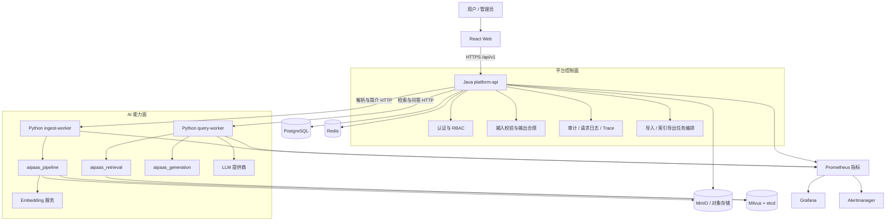
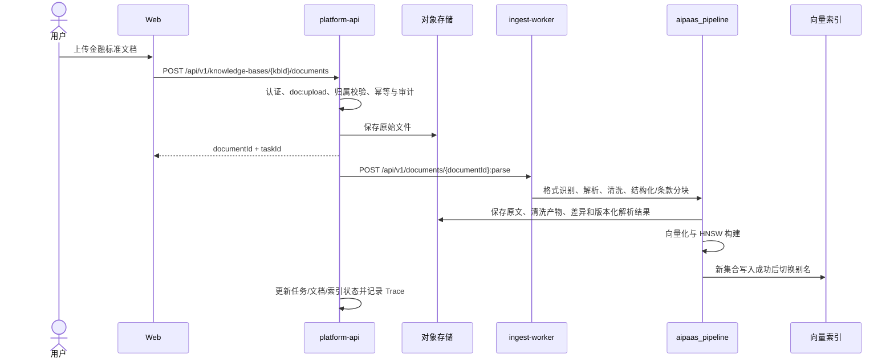
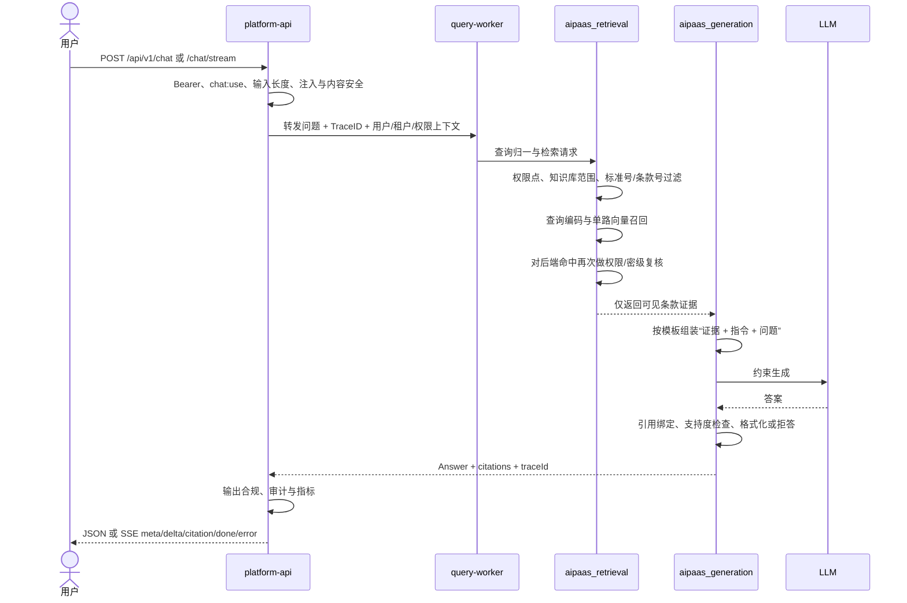

# AIPaaS 架构说明

> 适用对象：金融标准化知识库问答平台（AI PaaS）
> 当前基线：P0，OpenAPI 契约 `1.1.0-p0`
> 本文原则：区分**逻辑架构、当前代码实现、容器部署状态和后续规划**，不把契约预留或离线验收替身描述为已上线的生产能力。

## 1. 架构目标与边界

平台围绕金融标准的“可追溯问答”建设，核心链路为：

```text
文档上传 → 解析与清洗 → 结构化/条款级分块 → 向量化与索引
→ 标准号/条款号检索 → 权限过滤 → 约束生成 → 引用/拒答 → 导出与审计
```

P0 的关键约束：

- **契约先行**：`aipaas-contracts` 是跨端接口唯一权威来源。
- **统一入口**：Java `platform-api` 承担认证、RBAC、输入/输出安全、审计和跨语言编排。
- **AI 能力内聚**：Python workspace 承担解析、分块、索引、检索、生成和标准简介。
- **证据约束**：答案必须能回溯到标准、条款和分块；无证据时明确拒答。
- **最小治理**：P0 只做事件驱动任务、局部超时/重试/熔断/降级，不建设统一 API 网关。
- **明确分期**：混合检索、重排、多轮会话、OCR、多租户管理等不得因契约预留而被视为 P0 已实现。

完整验收结论见 [P0 集成验收报告](./acceptance/P0-ACCEPTANCE-REPORT.md)。

## 2. 逻辑架构总览



### 2.1 控制面与能力面的职责划分

| 层 | 核心职责 | 不应承担的职责 |
| --- | --- | --- |
| Web | 对话、文档导入、知识库、导出和个人中心界面；展示引用、拒答和任务状态 | 权限最终判定、检索过滤、审计伪造防护 |
| Java 平台 | Bearer 认证、权限点与对象归属校验、统一响应、任务编排、内容安全、审计、导出、可观测聚合 | 文档解析算法、向量计算、Prompt 生成算法 |
| Python AI | 解析清洗、条款分块、向量化、HNSW 索引、查询归一、向量召回、权限裁剪、约束生成、引用与拒答 | 绕过 Java 对外暴露平台管理接口 |
| 契约与 Mock | 冻结 API、字段、错误码、权限和审计声明；支持前后端独立联调 | 代替真实模型效果或生产数据验证 |
| 基础设施 | 元数据、对象、向量、缓存、监控和告警 | 在应用层之外隐式实现业务权限 |

## 3. 当前代码与模块映射

### 3.1 实际目录

```text
aipaas/
├── aipaas-contracts/              # OpenAPI、版本策略、零依赖 Mock、契约校验
├── javaplat/
│   ├── apps/platform-api/         # Spring Boot 3 / Java 21 平台主服务
│   └── libs/common/               # 统一响应、错误、Trace 等公共能力
├── pymodules/
│   ├── apps/
│   │   ├── rag-ai-api/            # P0 FastAPI 契约骨架，容器端口 8100
│   │   ├── ingest-worker/         # 文档导入与 P0 解析/简介/元数据接口，默认 8001
│   │   ├── query-worker/          # 检索、生成、问答与 SSE，默认 8002
│   │   ├── model-embedding-worker/# BGE-M3 / 在线 Embedding，默认 8003
│   │   └── model-reranker-worker/ # 开发全量链路重排服务，默认 8004
│   ├── packages/
│   │   ├── pipeline/              # 解析、清洗、分块、向量化、索引、简介
│   │   ├── retrieval/             # 查询归一、向量召回、权限过滤、审计
│   │   ├── generation/            # Prompt、LLM、引用、拒答、输入校验
│   │   ├── common/                # 配置、日志、上下文、SSE、可观测
│   │   └── model-clients/         # LLM / Embedding / Reranker 客户端
│   ├── scripts/acceptance/        # 可复现的 P0 端到端、质量、性能和安全验收
│   └── tests/                     # Python 自动化测试
├── web/                           # React 18 + Vite + Nginx
├── deploy/docker/                 # P0 编排、开发全量编排、监控配置
└── docs/                          # 架构、部署、解析、验收与演进文档
```

### 3.2 模块实现状态

| 模块 | 当前实现 | 必须注意的状态 |
| --- | --- | --- |
| `aipaas-contracts` | OpenAPI 3.1，`1.1.0-p0`；70 path、80 operation、177 schema，覆盖 44 项 P0 功能 | 契约存在不等于对应容器路由已经实现 |
| `platform-api` | Java 21 / Spring Boot 3.4；认证、知识库、文档、任务、RBAC、审计、导出、内容安全、Trace 和指标 | 容器内监听 **8080**；通过 HTTP 调用 Python 下游 |
| `rag-ai-api` | `/healthz`、`/readyz`、`/metrics`、`/api/v1/system/info` | **仍是契约骨架**；其他 `/api/v1/**` 返回 501，不是完整 AI 服务 |
| `ingest-worker` | FastAPI；注册 P0 解析、清洗差异、分块、元数据、Embedding、标准简介等路由 | 默认端口 **8001**；Java 的解析下游地址需显式指向实际服务 |
| `query-worker` | FastAPI；注册 P0 检索、`/api/v1/chat`、`/api/v1/chat/stream`，以及历史开发链路路由 | 默认端口 **8002**；真实问答应指向该实现，而非骨架 |
| `aipaas_pipeline` | PDF/DOCX/Excel/Markdown 解析、清洗、结构化/条目化分块、Embedding 任务、HNSW 索引、简介 | 扫描件 OCR 不在 P0；离线验收可使用内存索引和确定性编码器 |
| `aipaas_retrieval` | 标准号/条款号归一、向量召回、知识库与密级过滤、降级和审计 | P0 仅 `vector`；向量后端故障当前显式降级，不含 BM25 回退 |
| `aipaas_generation` | 双供应商客户端、模板版本、引用约束、格式化、拒答和故障处理 | 离线验收使用抽取式 Stub；真实模型接入后必须重新验收 |
| `web` | `/chat`、`/import`、`/knowledge`、`/exports`、`/user`；P0 API 客户端 | 登录页仍为 localStorage 演示登录，不等于 Java Bearer 登录已完成前端联调 |
| `contracts-mock` | 零依赖契约 Mock 与上传→问答冒烟脚本 | 仅用于接口/UI 联调，不验证真实解析、向量检索和 LLM 效果 |

## 4. 核心调用链

### 4.1 知识构建与索引



关键设计：

1. **事件驱动**：上传事务提交后异步分发，不用定时轮询驱动 P0 主流程。
2. **版本化产物**：清洗不得覆盖原始解析结果；重试和重解析不能产生重复 Chunk。
3. **条款锚点**：Chunk 保留 `documentId / clauseNo / chapterPath / pageNo / standardNo` 等定位信息。
4. **可恢复索引**：默认 `HNSW / COSINE`，`M=16`、`efConstruction=200`；新索引 READY 后再切别名，失败保留旧索引。
5. **失败可解释**：不支持的扫描件返回 `PARSE.PDF_SCANNED`，不能静默生成空知识库。

### 4.2 检索、问答与引用



检索权限必须在**召回前约束范围、召回后再次复核**，不能依赖 Prompt 告知模型“不要泄露”。生成服务只能拿到裁剪后的证据。

### 4.3 标准简介与条目化导出

- 标准简介优先从原文抽取标准编号、名称、范围、技术内容和实施日期；缺失项标为“未识别”，保留来源，不得补写。
- 导出采用异步任务：创建时校验 `export:create` 和知识库归属，下载时再次校验 `export:read`。
- 导出文件进入加密对象存储并设置有效期；记录操作人、范围、条款数、文件哈希和审计事件。
- 条目化导出必须满足“导出条目数 = 条款数”，验收样例覆盖 JSON/XLSX，平台契约覆盖 PDF/XLSX。

## 5. 数据与存储设计

### 5.1 领域关系

```text
KnowledgeBase
  └── Document ─── StandardMeta / Summary
        ├── IngestTask
        ├── Chunk ─── Citation
        └── Clause

KnowledgeBase ─── IndexBuild / EmbeddingJob / ExportJob
User ─── Role ─── Permission
AuditLog / RequestLog / TraceSpan：按对象与 TraceID 横切关联
```

字段和枚举以 [P0 领域模型](./architecture/00-p0-domain-model.md) 与 OpenAPI 为准。`tenantId` 从 P0 起保留，但多租户管理策略属于后续阶段。

### 5.2 存储职责

| 存储 | P0/开发职责 | 持久化与恢复要点 |
| --- | --- | --- |
| PostgreSQL | 用户、角色、知识库、文档、任务、审计、导出和平台元数据 | 每日备份；通过迁移脚本演进；恢复后做业务冒烟 |
| MinIO / 对象存储 | 原始文档、版本化解析产物、导出文件 | 原文与清洗产物分版本；导出加密并设置 TTL |
| Milvus | Chunk 向量与检索元数据 | 可从原文和解析产物重建；保留集合快照 |
| etcd | Milvus 元数据依赖 | 与 Milvus 同步备份/恢复，不单独承载业务数据 |
| Redis | P0 编排中的缓存/共享状态基础设施 | 可按缓存设计重建，不作为审计唯一来源 |
| 文件日志卷 | 结构化请求日志 | 默认保留 30 天，脱敏后归档 |
| MongoDB / Nacos / RocketMQ | 开发全量编排的历史会话、注册配置或消息能力 | **不是 P0 最小部署的必需业务存储** |

### 5.3 两类索引描述不能混用

- **P0 契约与验收主线**：条款级 Chunk、单路向量召回、HNSW 集合版本和别名热切换；向量维度由实际 Embedding 模型决定。
- **开发全量链路既有设计**：`kb_item_names` 文档主体级索引与 `kb_chunks` 切片级索引，可保存 BGE-M3 稠密/稀疏向量并执行混合检索。该设计属于现有开发链路能力，**不是 P0 验收的统一检索口径**。

## 6. 安全、审计与合规

| 控制点 | 实现位置 | 说明 |
| --- | --- | --- |
| 身份认证 | `platform-api` | Bearer Token；健康检查、登录等按契约豁免 |
| 权限判定 | `platform-api` + Python 检索层 | 认证 → 权限点 → 对象归属 → 业务规则；检索层再次裁剪 |
| 上传/删除/导出 | `platform-api` | 权限点与对象归属双重校验；下载导出再次授权 |
| 提示注入与输入审核 | Java 入口 + `aipaas_generation` | 在调用检索/LLM 前执行，正常问题需控制误拦 |
| 输出合规 | `OutputComplianceGuard` | 支持 JSON 与 SSE；跨 Chunk 违规可中断流；写审计与告警 |
| 审计 | Java / Python AuditSink | 记录操作者、动作、对象、结果和 TraceID，不记录密钥或完整敏感 Prompt |
| 保留策略 | `AuditRetentionService` / 请求日志配置 | 审计默认且不得低于 **180 天**；请求日志默认 30 天 |
| 传输与存储 | Nginx / 对象存储 | Web 支持 TLS1.2+；生产替换自签证书；导出文件加密 |

安全验收和已知边界见 [安全报告](./acceptance/security/SECURITY-REPORT.md) 与 [缺陷清单](./acceptance/DEFECT-LIST.md)。

## 7. 稳定性与可观测

### 7.1 稳定性策略

- 上传、解析和导出使用幂等键；重复请求不得重复创建业务产物。
- 导入任务支持状态跟踪和有限重试，默认最大重试 2 次。
- Python 调用设置连接/读取超时；Java 使用 Resilience4j 做局部治理。
- LLM 全部不可用时受控拒答，独立检索仍可使用。
- 向量后端超时或异常时返回 `degraded=true` 和明确原因；**P0 尚未实现 BM25 关键词回退**。
- 入口全局限流依赖反向代理/网关，不能用局部工具级限流替代全局容量保护。

### 7.2 日志、Trace、指标和告警

- `X-Trace-Id` 与统一响应信封中的 `traceId` 对齐；Java 调用 Python 时同时传递请求和权限上下文。
- Trace 覆盖解析、分块、向量化、索引、检索、生成等阶段，并支持按 TraceID 查询。
- Prometheus 抓取平台与 Python 指标；Grafana 提供请求、延迟、错误、资源和拒答等看板。
- Alertmanager 负责告警聚合与抑制，避免同一根因形成告警风暴。
- P95/P99 等性能结论必须注明真实模型或 Stub 环境，离线桩结果不能直接承诺生产模型时延。

## 8. 部署视图

### 8.1 P0 Compose：契约与平台交付骨架

`deploy/docker/docker-compose-p0.yaml` 启动 PostgreSQL、Redis、MinIO、etcd、Milvus、platform-api、rag-ai-api、Mock、Web、Prometheus、Alertmanager 和 Grafana。

| 服务 | 宿主机入口 | 容器内入口 | 用途 |
| --- | --- | --- | --- |
| Web | `18080 / 18443` | `80 / 443` | SPA、API 反代、HTTP/HTTPS |
| Mock | `4010` | `4010` | 契约联调与冒烟 |
| platform-api | 默认不映射 | **8080** | Java 平台 API |
| rag-ai-api | 默认不映射 | **8100** | Python 契约骨架 |
| PostgreSQL | 默认不映射 | `5432` | 平台元数据 |
| Redis | `56379` | `6379` | 缓存基础设施 |
| MinIO | `19000 / 19001` | `9000 / 9001` | S3 API / 控制台 |
| Milvus | `29530 / 29091` | `19530 / 9091` | 向量服务 / 健康与指标 |
| Prometheus | `19090` | `9090` | 指标与告警规则 |
| Grafana | `13000` | `3000` | 看板 |
| Alertmanager | `19093` | `9093` | 告警聚合 |

当前 P0 Compose 的集成边界：

1. `AIPAAS_CHAT_SERVICE_URL` 默认指向 `rag-ai-api:8100`，而后者仍返回业务 501；完整问答下游应切换到实现契约的 `query-worker`。
2. Java 解析下游默认为 `ingest-worker:8000`，P0 Compose 未启动该服务；实际联调必须设置 `AIPAAS_PARSE_SERVICE_URL` 并保证网络、接口路径一致。
3. 因此，这套编排可用于**服务健康、平台接口、契约 Mock、监控和部署验证**，不能仅凭容器健康就认定真实 AI 全链路已容器化。

### 8.2 开发全量 Compose

`deploy/docker/docker-compose.yaml` 通过 `include` 引入基础中间件，启动：

- `svc-ingest`：默认 8001；
- `svc-query`：默认 8002；
- `svc-model-embedding`：默认 8003；
- `svc-model-reranker`：默认 8004；
- 前端及核心中间件；Attu、Nacos、Redis、RocketMQ、vLLM 等按 profile 启用。

该链路包含历史商品主体识别、混合检索、重排、联网搜索等开发能力，与 P0 金融标准契约主线并存。部署时必须先选定目标，不要混用两套端口和上游配置。

### 8.3 离线验收环境

`pymodules/scripts/acceptance/` 直接复用生产 Python 包，以确定性 TF-IDF 编码器、抽取式 LLM Stub、内存检索/HNSW 替身复现功能、质量、性能和安全证据。它验证的是**算法与业务逻辑基线**，不替代真实 Milvus、Embedding、LLM、OCR、MinIO 和浏览器端的生产验收。

## 9. P0 与后续能力边界

| 能力 | 当前结论 |
| --- | --- |
| 标准号/条款号定位、向量召回、引用、拒答、简介、条款导出 | P0 主链路，已有自动化验收证据 |
| 真实 LLM、Embedding、Milvus 生产集群 | 需按部署环境接入并复测；离线验收使用明确标注的替身 |
| 扫描件 OCR / 多模态图片理解 | P0 不支持；扫描件明确失败，不能按文本 PDF 通过 |
| BM25、混合召回、Cross-Encoder 重排 | P1；开发全量链路中的既有能力不自动并入 P0 验收 |
| HyDE、联网搜索、Agent / Skill | 非 P0 主线；P0 能力选择器仅开放 RAG |
| 多轮会话、长期记忆 | P1；P0 为单轮问答 |
| SSO / MFA、完整多租户管理 | 后续阶段；P0 仅保留必要身份与租户字段 |
| 统一 API 网关、分布式全局限流、灰度路由 | P1；P0 只做局部最小治理 |
| 定时调度 | P1；P0 主流程为事件驱动 |
| 密级、领域、生效期等完整治理 | 按契约分期；预留字段不等于全部策略已启用 |

## 10. 文档与证据索引

- 使用入口：[快速使用入门](./00_快速使用入门.md)
- 部署：[P0 部署手册](./acceptance/P0-DEPLOYMENT-MANUAL.md)
- 契约：[aipaas-contracts](../aipaas-contracts/README.md)
- 领域模型：[P0 领域模型](./architecture/00-p0-domain-model.md)
- 契约评审：[P0 API 评审](./architecture/01-p0-api-review.md)
- 解析设计验证：[解析链路报告](./parse-pipeline/PARSE-REPORT.md)
- 质量评估：[Golden Set 评估报告](./acceptance/quality/GOLDEN-EVAL-REPORT.md)
- 性能与故障：[压测报告](./acceptance/perf/LOAD-TEST-REPORT.md)
- 端到端证据：[E2E 报告](./acceptance/e2e/E2E-REPORT.md)
- 上线：[上线检查单](./acceptance/GO-LIVE-CHECKLIST.md)

> `docs/architecture/02-p0-skeleton-runbook.md` 记录 Step 0 历史骨架状态；当前端口和集成边界以本文、快速入门及 P0 部署手册为准。
