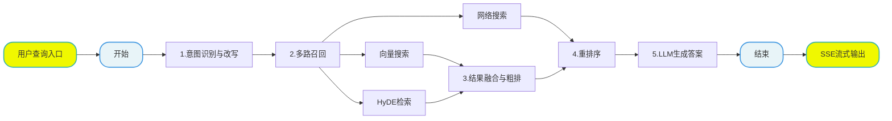

# 待办事项
GPU版本支持

# 架构逻辑

## 知识库构建

## 用户查询过程

## 向量库设计和说明

**文档级索引（kb_item_names）**

核心定位：作为检索的 “一级筛选器”，快速锁定目标文档范围，减少全库切片检索的性能损耗。

| 字段名        | 字段类型          | 核心作用                                                     |
| :------------ | :---------------- | :----------------------------------------------------------- |
| pk            | Int64（自增主键） | 文档级唯一标识，用于数据管理与关联                           |
| file_title    | VarChar(65535)    | 原始文档名称，用于数据溯源与文档级管理                       |
| item_name     | VarChar(65535)    | 文档核心主体（如 “iPhone 17 Pro Max”），解决跨文档主体模糊问题 |
| dense_vector  | FloatVector(1024) | 主体名称的语义向量，支持模糊语义匹配                         |
| sparse_vector | SparseFloatVector | 主体名称的关键词向量，支持专业术语、实体的精确匹配           |

**切片级索引（kb_chunks）**

**核心定位**：检索的 “精准匹配层”，存储细粒度语义切片，直接为大模型提供上下文证据。

| 字段名        | 字段类型          | 核心作用                                                     |
| :------------ | :---------------- | :----------------------------------------------------------- |
| chunk_id      | Int64（自增主键） | 切片全局唯一标识，作为数据操作主键                           |
| content       | VarChar(65535)    | 切片文本内容，是向量编码的核心数据源                         |
| title         | VarChar(65535)    | 切片所属完整标题路径（如 “操作手册 - 故障排查 - 电源故障”），补足上下文 |
| parent_title  | VarChar(65535)    | 切片所属父级标题，强化层级关联                               |
| part          | Int8              | 切片分段标识，用于超长段落二次切片后的顺序管理               |
| file_title    | VarChar(65535)    | 关联原始文档名称，实现切片 - 文档溯源                        |
| item_name     | VarChar(65535)    | 关联文档级核心主体，解决切片主语缺失问题                     |
| sparse_vector | SparseFloatVector | 切片关键词向量，适配精确检索，提升术语匹配精度               |
| dense_vector  | FloatVector(1024) | 切片语义向量，适配模糊语义检索，提升上下文匹配度             |

核心设计亮点总结

1. **双层索引架构**：先通过文档级索引快速缩小检索范围，再通过切片级索引精准匹配语义，兼顾检索效率与精度；
2. **混合向量支撑**：两类索引均同时存储稠密 / 稀疏向量，适配 BGE-M3 模型输出，兼顾 “语义泛化” 与 “关键词精准”；
3. **元数据增强**：通过 item_name、title 等元数据补足切片语义，从根源解决 RAG 检索的上下文缺失、主体模糊问题。