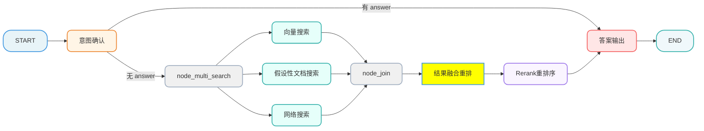
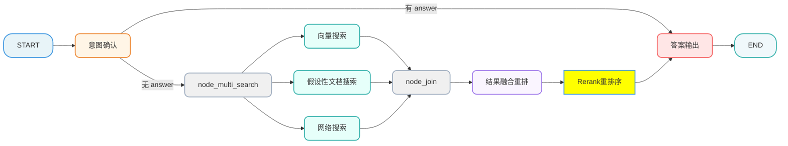

[TOC]

# 粗排RRF同源重排

## 1. 任务目标

### 1.1 涉及模块 

```
processor/query_processor/nodes/
├── node_rrf.py
```

### 1.2 节点在流程中的位置



## 2. 节点业务流程

### 2.1 节点作用

该节点负责将多路检索结果通过 **Reciprocal Rank Fusion（倒数排名融合）** 算法进行融合，生成统一的排序结果。

### 2.2 RRF介绍

Milvus文档：[RRF 排序器 | Milvus 文档](https://milvus.io/docs/zh/rrf-ranker.md)

#### 2.2.1 什么是 RRF？

简单来说，RRF 就像是一个"多路投票系统"。在这个项目中，当用户提问时，系统会同时从多个渠道找答案：

- 向量搜索（node_search_embedding）：通过语义相似度找相关文档
- HyDE 搜索（node_search_embedding_hyde）：先假设一个答案，再用这个假设去搜
- 网络搜索（node_web_search_mcp）：从互联网上找相关信息

这三路搜索结果各有优劣，RRF 的作用就是把它们公平地合并成一个统一的排名。

#### 2.2.2 为什么要用 RRF？

##### 1️⃣ 不同来源的分数不可比

想象一下：

- 向量搜索说："文档A 得分 0.95"
- HyDE 搜索说："文档B 得分 85.3"
- 网络搜索说："文档C 相关度排第2"

这三个分数的量纲完全不同（有的是 0~1，有的是原始距离，有的是排名），直接相加就像把"米"和"公斤"加在一起，没有意义。
RRF 的解决方案：不看绝对分数，只看排名位置。

一个搜索路的倒数分数计算公式是：`RRF 得分 = 1 / (k + 排名)`

其中 k 是常数（通常取 60）。这样无论原始分数是多少，都转换成统一的"排名权重"。

##### 2️⃣ 三路搜索各有特长

- 向量搜索：擅长理解语义，但可能漏掉关键词匹配的文档
- HyDE：能通过假设性答案找到间接相关的文档
- 网络搜索：提供最新的、知识库外的信息

如果只选一路，可能会错过其他路找到的好答案。RRF 让在多路中都排名靠前的文档获得更高的综合得分，实现"众人拾柴火焰高"。

##### 3️⃣ 鲁棒性强，不依赖单一模型

假如某一路搜索出了问题（比如向量模型对某个专业术语理解偏差），其他两路还能补救。RRF 相当于民主投票，避免"一言堂"。

##### 4️⃣ 无需训练，即插即用

相比需要训练的融合模型（如学习-to-rank），RRF 是一个无参数算法，不需要额外数据训练，直接基于排名就能工作，简单高效。

#### 2.2.3 RRF 算法原理

**Reciprocal Rank Fusion（倒数排名融合）** 是一种经典的排名融合算法。

##### 核心公式

$$
RRF\_score(d) = \sum_{i=1}^{n} \frac{weight_i}{k + rank_i(d)}
$$

##### 参数说明

| 参数      | 说明                                      |
| --------- | ----------------------------------------- |
| d         | 待评分的文档                              |
| n         | 检索路数                                  |
| weight_i  | 第 i 路的权重                             |
| rank_i(d) | 文档 d 在第 i 路中的排名位置（从 1 开始） |
| k         | 平滑常数（通常取 60）                     |

```
假设有文档 A，在两路检索中的基本信息如下：

路径           排名      贡献分数 (k=60, weight=1.0)
─────────────────────────────────────────────────────
向量检索          1        1.0/(60+1) = 0.0164
HyDE 检索         3        1.0/(60+3) = 0.0159
─────────────────────────────────────────────────────
                         总分 = 0.0323
```

###### 常数 k 的作用

k 值决定了排名差异对得分的影响程度：

> 排名位置对得分的影响（k=60）：
>
> - 排名 1:  1/(60+1)  = 0.0164
>
> - 排名 2:  1/(60+2)  = 0.0161  (仅下降 1.8%)
> - 排名 10: 1/(60+10) = 0.0143  (下降 13%)
> - 排名 50: 1/(60+50) = 0.0091  (下降 45%)
>
> 排名位置对得分的影响（k=0）：
>
> - 排名 1:  1/1   = 1.0000
> - 排名 2:  1/2   = 0.5000  (下降 50%)     ← 剧烈下降！
> - 排名 10: 1/10  = 0.1000  (下降 90%)     ← 更剧烈
> - 排名 50: 1/50  = 0.020  (下降 99.8%)   ← 几乎归零
>
> k=60 的作用就像"缓冲垫"：
>
> - 有 k=60：排名靠前的文档之间分数差距很小（第1名和第2名只差 1.8%），即使排到第10名，分数也只降了 13%。这样多个来源的检索结果能相对公平地竞争。
> - 没有 k（k=0）：排名第1的文档分数是 1.0，但排名第2的直接腰斩到 0.5，排名第10的只剩 0.1。这会导致**"赢家通吃"**——只要某个文档在任何一个来源中排第1，它的分数就会远远超过其他所有文档，RRF 的融合效果就失去了意义。
>
> 类比： 想象比赛打分：
>
> - k=60：冠军得 100 分，亚军得 98 分，季军得 96 分……大家都有机会
> - k=0：冠军得 100 分，亚军只得 50 分，季军只得 33 分……冠军优势太大，其他人很难追上
> - 所以 k=60 是为了让不同排名的文档分数差距不要太大，保证多路检索融合时的公平性。

###### k 值选择

- k 较小（如 10）：头部排名差异影响大，适合高精度场景
- k 较大（如 60）：排名差异影响平滑，适合多路融合
- 实践中 k=60 是经过验证的经典选择

###### 加权的意义

不同检索路径的可靠性可能不同，通过权重调节：

```python
search_source = {
    "vector_search_result": (docs, 1.0),   # 向量检索，权重 1.0
    "hyde_search_result": (docs, 1.0),     # HyDE 检索，权重 1.0
}
```

#### 2.2.4 总结：RRF 的优势

| 特点           | 说明                            |
| -------------- | ------------------------------- |
| **无需标准化** | 只看排名，不看原始分数          |
| **抗噪声**     | 平滑常数 k 防止头部排名过度主导 |
| **鼓励共识**   | 多路命中的文档得分更高          |
| **惩罚离散**   | 只在少数路径命中的文档得分较低  |

### 2.3 步骤分解

1）获取上游检索节点返回的文档

2）为不同来源设置权重

3）利用RFF公式融合多路搜索结构

### 2.4 代码实现

# 精排Rerank模型重

## 1. 任务目标

### 1.1 涉及模块 

```
processor/query_processor/nodes/
├── node_rerank.py
```

### 1.2 节点在流程中的位置



## 2. 节点业务流程

### 2.1 节点作用

该节点使用 Reranker 模型对 RRF 融合结果和网络搜索结果进行精排，并通过断崖检测算法实现动态 TopK 截断。

###  2.2 重排序介绍

#### 2.2.1 什么是重排序

简单来说，RRF 是"粗排"，Rerank 是"精排"。就像招聘流程：

- RRF = HR 初筛简历（快速、批量，但不够精准）
- Rerank = 面试官深度评估（慢、细致，但更准确）

#### 2.2.2 为什么需要重排序？

##### 1️⃣ 向量搜索的局限性

向量搜索（包括 RRF 融合后的结果）有个致命问题：它只看语义相似度，不看真正的匹配度。
举个例子： 用户问："iPhone 17 的电池容量是多少？"
向量搜索可能召回：

- ✅ 文档A："iPhone 17 电池容量为 4823 mAh"（真正相关）
- ⚠️ 文档B："iPhone 16 的电池续航表现优秀"（语义相近，但答非所问）
- ⚠️ 文档C："手机电池保养技巧"（都提到"电池"，但不相关）

向量模型会觉得这三篇都跟"电池"有关，分数差不多。但它无法判断哪篇真正回答了问题。

##### 2️⃣ Cross-Encoder 的优势

###### 交叉编码器

Rerank 使用的 Cross-Encoder （交叉编码器）模型会做一件事：把"问题 + 文档"一起输入模型，让它们互相"对话"，判断真正的匹配度。
就像一个细心的面试官：

- 不仅看候选人的简历（文档内容）
- 还要对照岗位要求（用户问题）
- 逐字逐句判断："这篇文档真的回答了这个问题吗？"

###### 效果对比

```
向量搜索（Bi-Encoder - 双编码器）：Bi-Encoder 就像是一个"平行处理系统"，它把问题和文档分开编码，然后比较它们的相似度
  问题 → [编码器] → 向量A
  文档 → [编码器] → 向量B
  计算 cos(向量A, 向量B) → 相似度
  
Cross-Encoder（Rerank）：
  [问题 + 文档] → [联合编码器] → 直接输出相关性分数

```

###### 工作原理（生活化类比）

想象你要找对象，用了两种方式：

🔹 Bi-Encoder 方式（快速但粗糙）

1. 给你拍张照片 → 提取你的特征向量（身高、学历、爱好等）
2. 给候选人拍张照片 → 提取他的特征向量
3. 计算两个向量的相似度 → 看匹配度

```
你      → [编码器] → 向量A = [0.8, 0.3, 0.9, ...]
候选人  → [编码器] → 向量B = [0.7, 0.4, 0.8, ...]
                    
相似度 = cos(向量A, 向量B) = 0.92 ✅
```

**关键特点：**

- 你和候选人是独立评估的，互不影响
- 编码完成后，可以快速和成千上万个候选人比对
- 速度快，但可能忽略细节

🔹 Cross-Encoder 方式（慢速但精准）

1. 把你和候选人安排相亲 → 让两人面对面交流
2. 观察互动过程 → 看聊天是否投机、价值观是否匹配
3. 给出综合评分

```
[你 + 候选人] → [联合评估器] → 直接输出分数 0.85
```

**关键特点：**

- 两人是一起评估的，能看到互动细节
- 每次只能评估一对，速度慢
- 精度高，能发现细微的匹配/不匹配

##### 3️⃣"两阶段检索" 策略

先用 Bi-Encoder，再用 Cross-Encoder。

```
第1阶段：Bi-Encoder（向量搜索 + RRF）
  ├─ 从 100万篇文档中快速筛选出 50篇候选
  └─ 耗时：~10ms
  
第2阶段：Cross-Encoder（Rerank）
  ├─ 对这 50篇候选进行精确打分
  └─ 耗时：~500ms
  
最终：取前 3-10 篇最高分的文档
```

### 2.3 断崖检测

#### 2.3.1 什么是断崖检测

断崖检测（Cliff Detection） 是一种智能截断策略，用于在重排序（Rerank）后的文档列表中，自动识别"高质量文档"与"低质量文档"之间的分界线。
想象你站在悬崖边：

- 悬崖之上：前几篇文档的相关性分数很高且平稳（如 0.95, 0.92, 0.88）
- 悬崖边缘：某两篇相邻文档之间，分数突然大幅下降（如从 0.88 跌到 0.35）
- 悬崖之下：后续文档的分数都很低，属于"凑数"的低质量内容

断崖检测的目标就是找到这个"悬崖边缘"，只保留悬崖之上的高质量文档，丢弃悬崖之下的噪声。

#### 2.3.2 为什么需要断崖检测？

##### 1️⃣ 避免低质量文档干扰答案生成

大模型（LLM）在生成答案时，会参考所有传入的文档。如果混入了不相关的低质量文档：

- ❌ LLM 可能被误导，生成错误或无关的内容
- ❌ 答案变得冗长、啰嗦，包含大量无用信息
- ❌ 增加 Token 消耗，提高 API 成本

例子： 用户问："iPhone 17 电池容量是多少？"
✅ 高质量文档（前3篇）：明确提到 "iPhone 17 电池容量为 3349mAh"
❌ 低质量文档（第4篇起）：讲的是 "MacBook 的续航技巧" 或 "安卓手机充电指南"
如果不做断崖检测，把这 10 篇都传给 LLM，它可能会混淆信息，甚至开始讲安卓手机的充电方法...

##### 2️⃣ 动态适应不同查询的难度

不同的问题，能找到的相关文档数量是不同的：
断崖检测可以动态调整返回数量：

- 热门问题 → 保留 8-10 篇
- 冷门问题 → 只保留 2-3 篇

##### 3️⃣提升系统响应效率

减少传给 LLM 的文档数量：

- ⚡ 降低 Prompt 长度，加快 LLM 推理速度
- 💰 减少 Token 消耗，降低 API 费用
- 🎯 让 LLM 更聚焦于核心信息

### 2.4 完整流程对比

| 阶段 | 方法                  | 速度 | 精度  | 作用                             |
| ---- | --------------------- | ---- | ----- | -------------------------------- |
| 召回 | 向量搜索 + HyDE + MCP | ⚡ 快 | ★★    | 从海量文档中找出"可能相关"的候选 |
| 粗排 | RRF 融合              | ⚡ 快 | ★★★   | 多路投票，统一排名               |
| 精排 | Cross-Encoder Rerank  | 🐢 慢 | ★★★★★ | 精确判断每篇文档的真正相关性     |
| 截断 | 断崖检测              | ⚡ 快 | -     | 剔除低质量文档，避免噪声         |

### 2.5 步骤分解

1）把 RRF 得到的切片集合和MCP搜索结果进行合并

2）利用 Reranker 模型对文档进行打分、重排

3）根据相关性性评分，用动态 TopK 算法进行截取。

### 2.6 代码实现

# 重排序模型部署（待办）