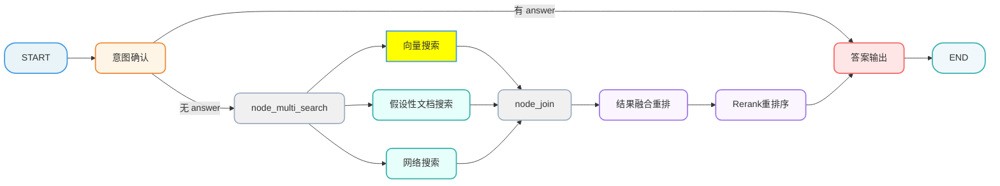
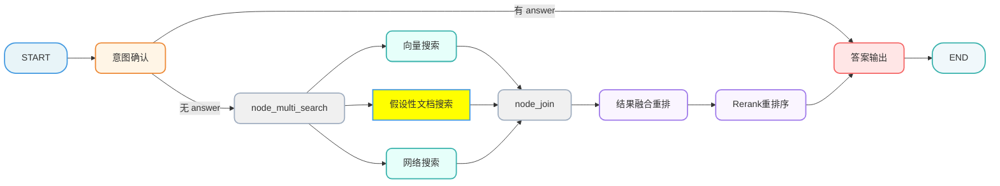
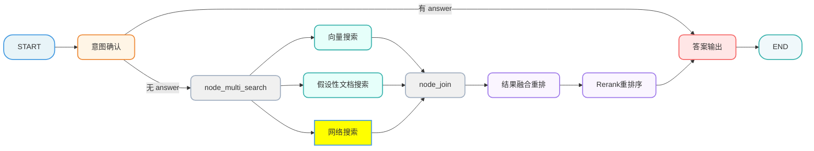

[TOC]

# Milvus向量库搜索

## 1. 任务目标

### 1.1 涉及模块 

```
processor/query_processor/nodes/
├── node_search_embedding.py
```

#### 1.2 节点在流程中的位置



## 2. 节点业务流程

### 2.1 节点作用

节点功能：基于已确认主体名+改写后的用户问题，执行Milvus向量数据库混合检索

### 2.2 流程说明

**1）获取查询上下文**
从状态（state）中提取经过改写的问题（`rewritten_query`）以及在上一节点确认的商品名称列表（`item_names`）。

**2）文本向量化**
调用嵌入模型接口，将改写后的问题转换为向量表示。这里同时生成两种向量：

*   **稠密向量 (Dense Vector)**：用于捕捉语义相似度。
*   **稀疏向量 (Sparse Vector)**：用于捕捉关键词匹配。

**3）构建混合检索请求**
准备 Milvus 混合搜索参数：

*   **过滤条件**：如果有确定的商品名，构造 `item_name in [...]` 过滤器，限定搜索范围。
*   **检索策略**：结合稠密向量（COSINE 距离）和稀疏向量（IP 内积）进行多路召回。

**4）执行向量检索**
连接 Milvus 数据库的 `CHUNKS_COLLECTION` 集合，执行混合检索。

*   **加权融合**：使用 0.8/0.2 的权重对稠密和稀疏得分进行重排序（Rerank）。
*   **结果截取**：返回 Top 5 最相关的文档切片（Chunks）。

**5）更新状态**
将检索到的文档切片列表（`embedding_chunks`）存入状态，供后续节点使用。

# HYDE假设性文档搜索



## 2. 节点业务流程

### 2.1 节点作用

**什么是HyDE**: HyDE（Hypothetical Document Embeddings，“假设文档向量化”）是一种让检索更“聪明”的技巧。当用户只给出一句短问题时，系统先不急着去向量库里硬搜，而是先让大模型“脑补”出一段可能的答案或相关描述——就像先写一段“假想的说明书”。这段文字通常更具体、更像一篇小文档，包含更多关键词、背景和表达方式。接着，把这段“假想文档”做成向量，再拿它去向量库里找相似内容。结果往往比直接拿那一句短问题去做向量检索更准，因为检索时用的是更“饱满”的语义信号。

它的**优点**是简单、通用、对很多场景都有效；**缺点**是也会“脑补过头”，生成的假设文本可能带偏方向，所以常见做法是配合过滤、重排或多路检索一起用。

**方案A：不用 HyDE（直接搜）**

```
用户问题："HAK180 烫金机怎么用？"
      ↓
 生成向量（短文本）
      ↓
去 Milvus 搜索
```

❌ 可能遇到的问题：

1. 语义太稀疏

   - "怎么用" 这3个字几乎没信息量
   - 向量模型很难从这么短的文本里提取出丰富的语义特征
   - 就像你去图书馆只说"我要看书"，管理员很难帮你找

2. 匹配不到专业术语

   - 数据库里的文档可能是：

     ```
          "HAK180 烫金机的操作步骤如下：
           1. 接通电源...
           2. 调节温度至 150°C...
           3. 放置材料..."
     ```

   - 你的查询只有"怎么用"，和文档里的"操作步骤""调节温度"等关键词语义距离很远

   - 结果：可能搜不到，或者召回的文档相关性很差

**方案B：用 HyDE（先生成假设答案，再搜）**

```
用户问题："HAK180 烫金机怎么用？"
         ↓
   LLM 生成假设答案：
   "HAK180 烫金机的使用方法包括：
    首先需要接通电源并预热设备，
    然后将温度调节到合适的范围（通常 120-180°C），
    接着将待烫印的材料放置在平台上..."
         ↓
    对这段"假设答案"生成向量（长文本，语义丰富）
         ↓
   去 Milvus 搜索
```

✅ 优势：

1. 语义更丰富
   - 假设答案里有"预热""温度调节""放置材料"等专业词汇
   - 这些词和真实文档里的表述高度重合
   - 向量相似度会更高
2. 桥接"问题"和"答案"的语义鸿沟
   - 问题通常是简短、口语化的
   - 答案通常是详细、专业化的
   - HyDE 相当于让 LLM 先"脑补"一个答案，用这个答案的语义去匹配真实文档
3. 提高召回率
   - 即使用户问得很模糊（比如"这个怎么用"），HyDE 也能生成包含专业术语的假设文档
   - 更容易命中知识库里的相关内容

**类比理解**

想象你在找一个菜谱：

❌ 不用 HyDE（直接搜)

```
你说："怎么做红烧肉？"
搜索引擎只能匹配标题里有"红烧肉"的菜
→ 可能找到，也可能找不到（如果文档叫"五花肉炖煮指南"就漏了）
```

✅ 用 HyDE（先脑补再搜）

```
你说："怎么做红烧肉？"
LLM 脑补："红烧肉需要先将五花肉切块，用料酒腌制，然后炒糖色..."
用这段脑补内容去搜
→ 即使文档叫"五花肉炖煮指南"，但因为里面有"切块""料酒""炒糖色"等词，也能匹配上
```

### 2.2 实现思路

**1）利用大模型根据用户查询生成假设性文档（Hypothetical Document）。**

**2）利用“重写问题 + 假设性文档”生成 embedding，并到向量库检索切片。**

### 2.3 代码实现

# MCP网络搜索

## 1. 任务目标

### 1.1 涉及模块 

```
processor/query_processor/nodes/
├── node_web_search_mcp.py
```

#### 1.2 节点在流程中的位置



## 2. 节点业务流程

### 2.1 mcp的调用的准备工作

使用MCP 服务需先在阿里云百炼平台完成开通与配置，才能通过代码调用，以下是完整的开通流程说明：

**步骤1：前提条件**

已注册阿里云账号，并完成实名认证（百炼 MCP 服务需实名认证后使用）。

**步骤2：开通百炼 MCP 服务的详细步骤**

1、进入百炼 MCP 广场

打开浏览器，访问百炼 MCP 服务市场链接：[大模型服务平台百炼控制台](https://bailian.console.aliyun.com/cn-beijing/?spm=a2c4g.11186623.0.0.5f885389KrrOsZ&tab=mcp#/mcp-market)

2、搜索并选择目标 MCP 服务

​	在 MCP 广场的搜索框中输入关键词（如 “联网搜索”）；

​	在搜索结果中找到目标服务（如本场景的 “联网搜索”），点击服务卡片进入详情页。

/阶段08：RAG项目/1.代码/images/wps1-17699496797303-17732210276785.jpg)

**步骤 3：开通 MCP 服务**

进入服务详情页后，点击 “开通服务” 按钮，会弹出 “开通 MCP 服务” 配置窗口，需完成以下配置：


1. **选择 API Key**：从下拉框中选择已有的`DASHSCOPE_API_KEY`（若未创建，需先在百炼控制台的 “API 密钥管理” 中生成）；
2. 选择部署模式：
   - 推荐选择「个人 FC 资源部署」（资源独立、安全隔离，适合正式场景）；
   - 测试场景可选择「公共 FC 资源部署」（共享资源，启动更快）；
3. 选择计费模式（个人FC资源部署）：
   - 「基础模式」：按调用时长计费（0.000156 元 / 秒），调用后释放资源，成本低；
   - 「极速模式」：按部署时长计费（0.13 元 / 时），启动速度极快（冷启动≤5 毫秒），适合低延迟场景；
4. **选择部署地域**：建议选择与业务服务器同地域（如 “华东 2（上海）”），降低网络延迟；
5. 确认配置后，点击 “确认开通” 按钮，等待百炼平台完成服务部署（通常 1-2 分钟）。

**步骤 4：获取 MCP 服务地址**

开通完成后，在服务详情页的 “使用 MCP SDK 调用” 区域，复制对应的MCP 服务的 **Streamable HTTP Endpoint**，将该地址配置到`.env`文件的`MCP_DASHSCOPE_BASE_URL`中。

### 2.2 处理策略

#### 2.2.1 调用搜索工具

基于已建立的 MCP 连接，通过`call_tool()`调用百炼专属搜索工具`bailian_web_search`，**工具调用固定传参格式（JSON）**，参数不可随意修改：

```
{
  "tool_name": "bailian_web_search",  // 固定值，百炼搜索工具唯一标识
  "arguments": {
    "query": "步骤1提取的rewritten_query",  // 必选，搜索查询词
    "count": 5  // 可选，返回结果数量，默认5条（建议1-10）
  }
}
```

#### 2.2.2 解析与格式化

接收 MCP 流式响应，提取有效数据并清洗，最终封装为统一格式文档列表，为后续节点提供标准化数据。

① MCP 原始返回值（核心有效片段）

```json
{
  "type": "tool_call",
  "content": [
    {
      "text": "{\"pages\": [{\"title\": \"结果标题\", \"url\": \"结果链接\", \"snippet\": \"核心摘要\", \"source\": \"数据源\"}]}"
    }
  ]
}
```

② 解析规则

1. 过滤出`type: "tool_call"`的响应，提取`content[0].text`并转为 JSON 对象；
2. 提取对象中`pages`数组，遍历后仅保留`title`/`url`/`snippet`三个核心字段；
3. 对所有字段做清洗（去首尾空格、过滤空值），剔除`snippet`为空的无效结果。

③ 最终格式化结果（列表嵌套字典，统一格式）

```json
[
  {
    "title": "清洗后的结果标题",
    "url": "清洗后的结果链接",
    "snippet": "清洗后的核心摘要（非空）"
  }
]
```

#### 2.2.3 更新状态与资源清理

① 资源清理

无论调用成功 / 失败 / 中断，均通过`await search_mcp.cleanup()`关闭 MCP 连接，释放客户端资源，避免资源泄漏。

② 状态更新返回

将步骤 4 格式化后的文档列表，以`web_search_docs`为字段名更新到 LangGraph 全局状态并返回，供后续节点（重排序、大模型生成）使用；无有效结果则返回空字典。

最终返回状态（JSON）

```json
{
  "web_search_docs": [
    {
      "title": "HAK 180 烫金机官方操作手册",
      "url": "https://xxx.com/hak180/manual",
      "snippet": "HAK 180 顶部50-170mm局部烫金设置：操作面板【转印参数】-【区域设置】，选择顶部局部，输入起始50mm、结束170mm，保存生效"
    }
  ]
}
```

### 2.3代码实现

#### 2.3.1 准备和环境

安装 openai的sdk

```cmd
uv add openai-agents
```

在`.env`文件，添加以下配置：

```ini
# ===================== MCP =====================
# 百炼MCP WebSearch的SSE接口地址（固定值，无需修改）
MCP_DASHSCOPE_BASE_URL=https://dashscope.aliyuncs.com/api/v1/mcps/WebSearch/mcp
```

#### 2.3.2 定义读取配置文件

```python
# config/bailian_mcp_config.py

# 导入核心依赖：数据类、环境变量读取、路径处理
from dataclasses import dataclass
import os
from dotenv import load_dotenv

load_dotenv()


# 定义mcp的服务配置
@dataclass
class McpConfig:
    mcp_base_url: str
    api_key : str

mcp_config = McpConfig(
    mcp_base_url=os.getenv("MCP_DASHSCOPE_BASE_URL"),
    api_key=os.getenv("OPENAI_API_KEY")
)
```

#### 2.3.3 单元测试

```python
if __name__ == "__main__":

    init_state = {
        "rewritten_query": "关于brother HAK180烫金机，如何调节转印温度？"
    }

    # 执行节点的业务调用
    node_web_search_mcp = NodeWebSearchMcp()
    result = node_web_search_mcp(init_state)
    logger.info(serialize_json(result, indent=4))

```

#### 2.3.4 主流程定义

参考：[Model context protocol (MCP) - OpenAI Agents SDK](https://openai.github.io/openai-agents-python/mcp/)

##### 流程图